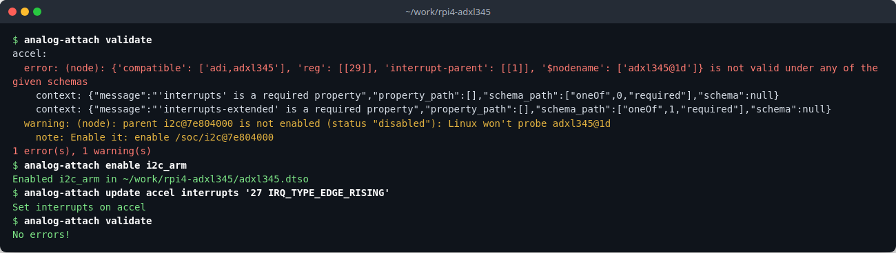

.. _cli-validate-build-deploy:

Validate, build and deploy
==========================

When the device's properties are set (see :ref:`cli-properties`), check the
overlay against the bindings, compile it, and copy it to the board.

Validate
--------

``validate`` runs dt-validate on the nodes the overlay writes, as they sit in
the base devicetree. It also checks addresses and chip selects, references
that name no node, and devices on a disabled bus:

.. code-block:: text

   $ analog-attach validate
   accel:
     error: (node): {'compatible': ['adi,adxl345'], 'reg': [[29]], '$nodename': ['adxl345@1d']} is not valid under any of the given schemas
       context: {"message":"'interrupts' is a required property",…}
       context: {"message":"'interrupts-extended' is a required property",…}
     warning: (node): parent i2c@7e804000 is not enabled (status "disabled"): Linux won't probe adxl345@1d
       note: Enable it: enable /soc/i2c@7e804000
   1 error(s), 1 warning(s)

The findings are grouped by node, errors first. Each says which property it is
about (``(node)`` for the node as a whole) and, when there is one, a note on how
to fix it. Here the interrupt is missing and the bus is off:

.. code-block:: text

   $ analog-attach update accel interrupt-parent gpio
   $ analog-attach update accel interrupts 27 IRQ_TYPE_EDGE_RISING
   $ analog-attach enable i2c_arm
   $ analog-attach validate
   No errors!

   ``analog-attach validate`` with an error, then fixed

With warnings only, it ends with ``No errors! (<n> warning(s))``. Act on the
warnings too: an address clash or a disabled bus means the device won't work
even though the overlay compiles.

Check the whole devicetree
~~~~~~~~~~~~~~~~~~~~~~~~~~

``validate`` alone doesn't check the properties the overlay sets on base nodes
(such as ``status`` or ``clock-frequency`` on ``i2c_arm``). ``--full`` also
validates the base devicetree with the overlay applied, and reports what the
overlay adds or sets there. It takes a few seconds:

.. code-block:: text

   $ analog-attach validate --full
   No errors!
   219 more finding(s) in the base devicetree

The findings of the base devicetree itself are only counted: they aren't the
overlay's to fix. A base node the overlay changes brings its own findings, which
are reported.

Run ``validate --full`` once before you deploy.

Build
-----

``build`` runs the project's ``AA_BUILD`` command in the project folder, by
default the script ``./aa_build.sh`` that ``init`` wrote. The starter script
compiles the overlay with ``dtc`` into a ``.dtbo`` in the ``build`` folder,
named after the overlay:

.. code-block:: text

   $ analog-attach build
   Building /home/user/work/rpi4-adxl345/overlay.dtso with AA_BUILD
   dtc -@ -I dts -O dtb -o /home/user/work/rpi4-adxl345/build/overlay.dtbo /home/user/work/rpi4-adxl345/overlay.dtso
   …: Warning (reg_format): /fragment@0/__overlay__/adxl345@1d:reg: property has invalid length (4 bytes) (#address-cells == 2, #size-cells == 1)
   …
   Build completed successfully

     /home/user/work/rpi4-adxl345/build/overlay.dtbo

The script's output is shown as it comes, on standard error. ``dtc`` doesn't
know the base devicetree when it compiles an overlay, so it warns about
``reg`` and ``#address-cells``: those warnings are expected. ``build`` does not
validate; run ``validate`` first.

If the command fails, ``build`` says so with its exit status:
``Build failed: AA_BUILD exited with status 1``.

Change the build
~~~~~~~~~~~~~~~~

* Edit ``aa_build.sh``: it is yours. ``analog-attach init --restore build``
  writes the starter again.
* Run another command: ``analog-attach config var AA_BUILD "make overlay"``.
  ``config var AA_BUILD --reset`` goes back to the script.
* Write the output elsewhere: ``analog-attach config build-dir out``.

The command gets its input in environment variables, such as ``AA_DTSO`` (the
overlay), ``AA_DTBO`` (the ``.dtbo`` to write), ``AA_BUILD_DIR`` and
``AA_DTC``, and every project variable. ``config var`` lists them (see
:ref:`cli-variables`).

A full devicetree instead of an overlay
~~~~~~~~~~~~~~~~~~~~~~~~~~~~~~~~~~~~~~~

Some boards (Zynq boards such as the Cora Z7S) boot one complete devicetree
and don't load overlays. For them, set:

.. code-block:: bash

   analog-attach config output devicetree

``build`` then writes the base devicetree with the overlay applied,
``build/overlay.dts``, preprocesses it, and the starter script compiles it into
``build/overlay.dtb``. ``deploy`` copies that ``.dtb`` instead.

Deploy
------

``deploy`` runs the project's ``AA_DEPLOY`` command, by default the script
``./aa_deploy.sh`` that ``init`` wrote. The starter script is for a Raspberry
Pi running Kuiper, reached over SSH. It:

#. checks that the board answers;
#. copies the ``.dtbo`` into the ``overlays/`` folder of the boot partition;
#. adds ``dtoverlay=<name>`` to ``config.txt`` when it isn't there;
#. **reboots the board**.

It needs ``ssh``, ``scp`` and ``sshpass`` on your computer, and the board in
three project variables. ``init`` sets them to Kuiper's defaults; change them
for your board:

.. code-block:: bash

   analog-attach config var BOARD_IP 192.168.2.10
   analog-attach config var BOARD_USER analog
   analog-attach config var BOARD_PASSWORD --secret

``BOARD_PASSWORD`` is a secret: its value is never stored. On a terminal,
``deploy`` asks for it, without showing what you type:

.. code-block:: text

   $ analog-attach deploy
   BOARD_PASSWORD:
   Deploying /home/user/work/rpi4-adxl345/build/overlay.dtbo with AA_DEPLOY
   Checking analog@192.168.2.10
   Copying overlay.dtbo to analog@192.168.2.10:/boot/firmware/overlays/overlay.dtbo
   Added dtoverlay=overlay to /boot/firmware/config.txt
   Rebooting analog@192.168.2.10
   Deploy completed successfully

In a script, give it in the environment:

.. code-block:: bash

   BOARD_PASSWORD=analog analog-attach deploy

Without it, a ``deploy`` that can't ask is refused with ``Secret variable
BOARD_PASSWORD is not in the environment``.

``deploy`` doesn't build. It copies what the last ``build`` wrote; when there
is nothing, the script stops with ``… not found: run analog-attach build
first``.

.. warning::

   ``deploy`` reboots the board. Save your work on the board first.

When the board is back, check that the driver probed, for example with
``iio_info -u ip:192.168.2.10`` on your computer.

Deploy another way
~~~~~~~~~~~~~~~~~~

For a board that isn't a Raspberry Pi running Kuiper, edit ``aa_deploy.sh``, or
run another command:

.. code-block:: bash

   analog-attach config var AA_DEPLOY "./flash-board.sh"

``analog-attach init --restore deploy`` writes the starter script again.

Next steps
----------

* :ref:`cli-scripting`: run the same steps from a script or CI.
* :doc:`/cli-guide/error-reporting`: what the messages and exit status mean.
