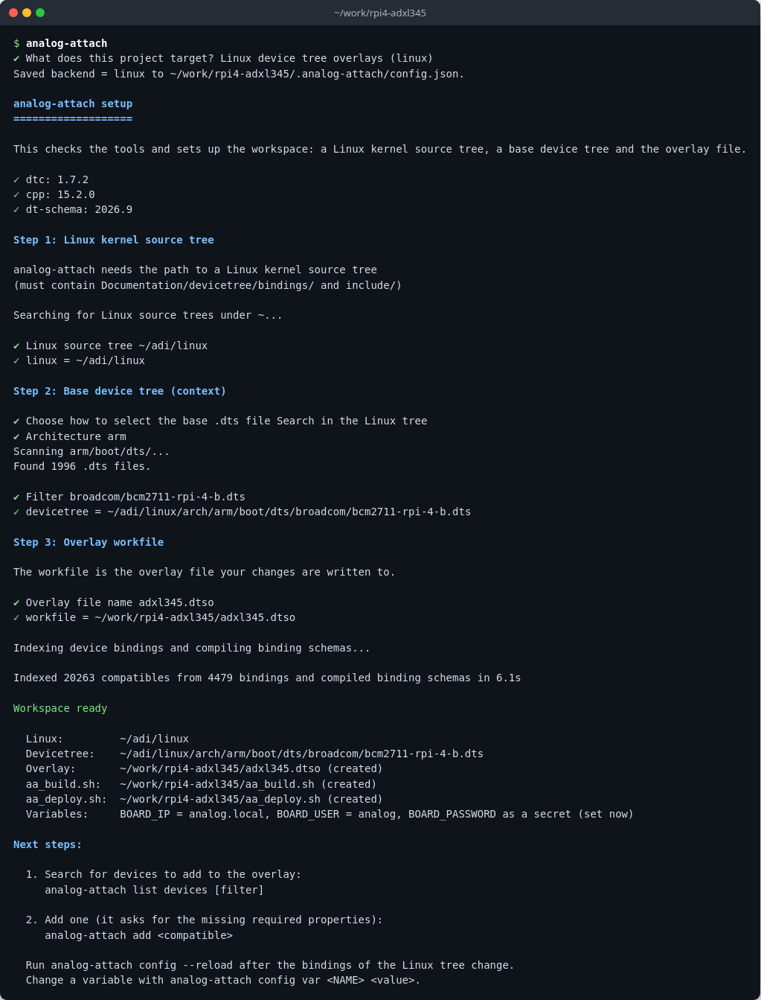

.. _cli-workfile:

Creating and reading the workfile
=================================

The workfile is the overlay that Analog Attach edits for you. This page shows
how to create it and read it from the command line. How the file is made and
what it contains is described in :doc:`/reference/linux/workfile`.

Create the workfile
-------------------

The project needs the ``linux`` and ``devicetree`` settings first (see
:ref:`cli-configuration`).

#. Name the workfile and set up the project:

   .. code-block:: bash

      analog-attach config workfile <name>.dtso

   Running ``analog-attach`` with no arguments in a terminal asks for the
   same information step by step.

#. Create it:

   .. code-block:: bash

      analog-attach init

``init`` creates the file only if it does not exist yet. It never picks another
name and never overwrites an existing file.

``init`` also writes the two scripts that ``build`` and ``deploy`` run,
``aa_build.sh`` and ``aa_deploy.sh``, in the project folder, and sets the
variables the deploy script uses (see :ref:`cli-variables`):

.. code-block:: text

   $ analog-attach init
   Workspace ready

     Linux:         /home/user/linux
     Devicetree:    /home/user/linux/arch/arm/boot/dts/broadcom/bcm2711-rpi-4-b.dts
     Overlay:       /home/user/work/rpi4-adxl345/overlay.dtso (created)
     aa_build.sh:   /home/user/work/rpi4-adxl345/aa_build.sh (created)
     aa_deploy.sh:  /home/user/work/rpi4-adxl345/aa_deploy.sh (created)
     Variables:     BOARD_IP = analog.local, BOARD_USER = analog, BOARD_PASSWORD as a secret (set now)

   Next steps:

     1. Search for devices to add to the overlay:
        analog-attach list devices [filter]

     2. Add one (it asks for the missing required properties):
        analog-attach add <compatible>

     Run analog-attach config --reload after the bindings of the Linux tree change.
     Change a variable with analog-attach config var <NAME> <value>.

Running ``init`` again is safe: each file that is already there is reported as
``(kept)`` and left as it is, including scripts you have edited. To get a
starter script back, run ``analog-attach init --restore build`` (or
``deploy``): it writes that script again over yours.

If a setting is missing, ``init`` creates nothing and says what to set:

.. code-block:: text

   $ analog-attach init
   Missing config field devicetree — Path to target base DTS file

   Run 'analog-attach' on a terminal, or 'analog-attach config devicetree <path>', to set up a workspace.

   The guided setup in a terminal (``analog-attach`` with no arguments)

Start from an overlay of the Linux tree
---------------------------------------

The kernel tree may already have an overlay for your device. ``list overlay``
finds the overlays that add it, and says whether they fit the board:

.. code-block:: text

   $ analog-attach list overlay adi,adxl345
   i2c-sensor-overlay.dts  compatible (family: brcm,bcm2835 → raspberrypi)

``import`` makes a new workfile from one, by name or from a file path:

.. code-block:: text

   $ analog-attach import i2c-sensor-overlay.dts
   Imported arch/arm/boot/dts/overlays/i2c-sensor-overlay.dts into /home/user/work/rpi4-adxl345/i2c-sensor.dtso
   The configured workfile is now /home/user/work/rpi4-adxl345/i2c-sensor.dtso (was /home/user/work/rpi4-adxl345/overlay.dtso, kept; switch back with: config workfile /home/user/work/rpi4-adxl345/overlay.dtso)
   Dropped __overrides__ (the overlay's parameters)

* The new workfile is named after the overlay and becomes the configured one.
  The previous workfile is kept; ``config workfile <file>`` switches back.
* Every fragment is imported as written. The ``__overrides__`` node (the
  Raspberry Pi overlay parameters) is dropped.
* Targets and references are not remapped. Those that the base devicetree
  doesn't have are listed as warnings: fix them with ``update`` (see
  :ref:`cli-properties`).

To copy only the device's node from an overlay into your own workfile, use
``add --template overlay:<name>`` instead (see :ref:`cli-devices`).

Read the workfile
-----------------

.. code-block:: bash

   analog-attach read
   analog-attach read <node>
   analog-attach read <node> <property>

``read`` alone prints the whole overlay:

.. code-block:: text

   $ analog-attach read
   /dts-v1/;
   /plugin/;
   / {
   	fragment@0 {
   		target = <&i2c_arm>;
   		__overlay__ {
   			status = "okay";
   			accel: adxl345@1d {
   				compatible = "adi,adxl345";
   				reg = <0x1d>;
   				interrupt-parent = <&gpio>;
   				interrupts = <27 1>;
   			};
   		};
   	};
   };

With a node, it prints that node, followed by the required properties it still
lacks. A node is named by its label, by a label and the path below it, or by
its absolute path (see :ref:`cli-node-paths`):

.. code-block:: text

   $ analog-attach read accel
   accel: adxl345@1d {
       compatible = "adi,adxl345";
       reg = <0x1d>;
   };
   Missing required: interrupt-parent, interrupts

With a property, it prints the value, the binding it comes from, and the
allowed values and suggestions when the binding has them. ``--quiet`` prints
the value alone:

.. code-block:: text

   $ analog-attach read accel status
   status = "disabled";
     (adi,adxl345.yaml)
     Allowed: okay | disabled | reserved | fail | fail-needs-probe
     Suggestions:
       okay  "okay"
       disabled  "disabled"
       …
   $ analog-attach read --quiet accel interrupts
   interrupts = <27 1>;

``read`` also reads the nodes and properties of the base devicetree, such as
``read i2c_arm``. To list every node of the board with the overlay applied, use
``list node`` (see :ref:`cli-devices`).
