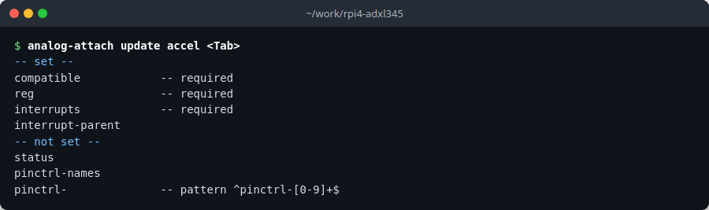

Shell completion
================

Analog Attach can complete commands, options and values when you press
:kbd:`Tab`. For example, it completes command names, the options of a command,
the devices of ``add``, the nodes and properties of ``update``, and the values
of ``config`` settings. Candidates come from the project's configuration and
workfile, so they are current.

Supported shells: **bash**, **zsh** and **fish**.

Completion calls ``analog-attach`` on your ``PATH`` each time you press
:kbd:`Tab`, so the package must be installed first (see :doc:`/install/index`).

Install the completion
----------------------

Run:

.. code-block:: bash

   analog-attach completion --install

The shell is taken from the ``SHELL`` environment variable. To choose one
explicitly:

.. code-block:: bash

   analog-attach completion bash --install
   analog-attach completion zsh --install
   analog-attach completion fish --install

``--install`` writes one file in your home directory, where the shell loads
completions from. It never edits a shell startup file such as ``~/.bashrc`` or
``~/.zshrc``. Installing again replaces the earlier file.

.. list-table::
   :header-rows: 1

   * - Shell
     - File written
     - What else to do
   * - bash
     - ``~/.local/share/bash-completion/completions/analog-attach``
     - Needs the ``bash-completion`` package. Open a new shell.
   * - zsh
     - ``~/.local/share/zsh/site-functions/_analog-attach``
     - Add the directory to ``fpath`` in ``~/.zshrc``, **before** ``compinit``
       (see below), then open a new shell.
   * - fish
     - ``~/.config/fish/completions/analog-attach.fish``
     - Open a new shell.

If ``XDG_DATA_HOME`` or ``XDG_CONFIG_HOME`` is set to an absolute path, it is
used instead of ``~/.local/share`` or ``~/.config``.

zsh
~~~

Add this line to ``~/.zshrc`` before the call to ``compinit``:

.. code-block:: bash

   fpath=(~/.local/share/zsh/site-functions $fpath)

bash
~~~~

If completion doesn't load in a new shell, check that the ``bash-completion``
package is installed. On Debian and Ubuntu:

.. code-block:: bash

   sudo apt install bash-completion

Try it without installing
-------------------------

To enable completion in the current shell only, source the script instead:

.. code-block:: bash

   source <(analog-attach completion bash)   # bash
   source <(analog-attach completion zsh)    # zsh
   analog-attach completion fish | source    # fish

To keep it, add the line to your shell's startup file.

Check that it works
-------------------

Type ``analog-attach`` followed by a space and press :kbd:`Tab` twice. The list
of commands should appear. Then try ``analog-attach config <Tab>``.

   Shell completion of a path

Remove the completion
---------------------

.. code-block:: bash

   analog-attach completion --uninstall

This removes the file that ``--install`` wrote. If you added an ``fpath`` line
to ``~/.zshrc``, remove it by hand.
