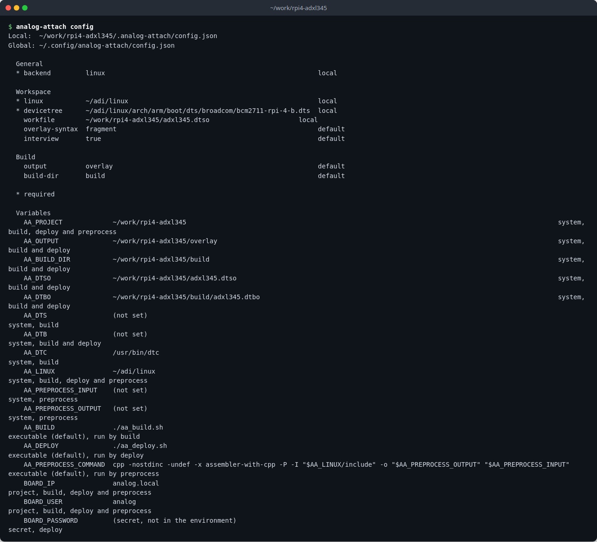

Configuration file
==================

Analog Attach reads its settings from JSON files. You normally change them with
``analog-attach config`` rather than by editing the files.

Where the files are
-------------------

.. list-table::
   :header-rows: 1

   * - File
     - Location
     - Purpose
   * - Local (project)
     - ``.analog-attach/config.json`` in the project root
     - Settings of this project. Only this file holds ``backend``.
   * - Global (user)
     - ``$XDG_CONFIG_HOME/analog-attach/config.json``, or
       ``~/.config/analog-attach/config.json`` if ``XDG_CONFIG_HOME`` is unset,
       empty or relative
     - Defaults shared by all projects.

The **project root** is the nearest directory, from the current directory
upward, that has a ``.analog-attach/`` folder (the home directory and the
filesystem root are not checked unless you are in them). If there is none, the
project root is the current directory.

A missing file is not an error: its settings are simply unset. A file that is
not valid JSON is reported with a hint to fix or remove it. The tool does not
read settings from environment variables.

How the project folder is created
---------------------------------

``.analog-attach/`` is created by the first command that writes a setting of
the project: ``analog-attach config <key> <value>`` (usually
``config backend linux``), the guided setup (``analog-attach`` with no
arguments), which saves each answer with ``config``, or the GUI's project
setup, which does the same. Commands that only read, such as ``config`` with no
value, create nothing. Setting ``linux`` then creates
``.analog-attach/linux/`` for the binding caches.

File format
-----------

Each file is one JSON object. ``backend`` is at the top level, and the settings
of the Linux backend are in an object named ``linux``, with the project's
variables in it. The file ``init`` leaves in the project of the
:ref:`cli-guide`:

.. code-block:: json

   {
     "backend": "linux",
     "linux": {
       "linux": "/home/user/linux",
       "devicetree": "/home/user/linux/arch/arm/boot/dts/broadcom/bcm2711-rpi-4-b.dts",
       "workfile": "/home/user/work/rpi4-adxl345/overlay.dtso",
       "variables": {
         "BOARD_IP": "analog.local",
         "BOARD_USER": "analog",
         "BOARD_PASSWORD": {
           "secret": true
         }
       }
     }
   }

* Keys are in kebab-case and the values of settings are strings, ``interview``
  included (``"false"``).
* ``config`` writes the paths it is given as absolute paths. A relative path
  written by hand in the local file is resolved against the project root, and
  a path that starts with ``~`` against the home directory. Whether the path
  exists is checked only when a command needs it.
* An unknown key is reported as an error, with the valid keys:

  .. code-block:: text

     /home/user/work/rpi4-adxl345/.analog-attach/config.json: unknown key linux.foo

     Remove unknown keys from /home/user/work/rpi4-adxl345/.analog-attach/config.json; valid keys in linux are linux, devicetree, workfile, overlay-syntax, interview, output, build-dir, variables.

* Only the section of the project's backend is read. A v0.2.0 file has only
  the ``linux`` section; any other section in it is ignored.
* Settings of earlier versions that are gone (``preprocess-command``,
  ``build-command``, ``deploy-command``, ``deploy-ip``, ``deploy-user``,
  ``deploy-password``) are unknown keys: remove them and set the variables of
  `Variables`_ instead. A file of the earlier flat format, with every key at the
  top level, is not converted either.

Precedence
----------

The value of a setting is the local file's, else the global file's, else the
default. ``analog-attach config <key>`` shows the value and where it comes from
(``local``, ``global``, ``default`` or ``unset``).

``backend`` and the variables belong to the project: they are not allowed in
the global file.

Settings
--------

``backend``
~~~~~~~~~~~

Required. The ecosystem the project targets. In v0.2.0 the only value is
``linux`` (Linux devicetree overlays).

Linux settings
~~~~~~~~~~~~~~

.. list-table::
   :header-rows: 1
   :widths: 18 14 10 20 38

   * - Key
     - Type
     - Required
     - Default
     - Meaning
   * - ``linux``
     - directory
     - yes
     - none
     - Path to the Linux kernel source tree. Setting it builds the binding
       caches.
   * - ``devicetree``
     - file
     - yes
     - none
     - Path to the base devicetree (``.dts``) of the target.
   * - ``workfile``
     - file
     - no
     - none
     - The overlay (``.dtso``) that ``init`` creates and the commands edit. See
       :doc:`/reference/linux/workfile`.
   * - ``overlay-syntax``
     - ``fragment`` or ``reference``
     - no
     - ``fragment``
     - How the overlay is written: ``fragment@0 { target = <&spi0>;
       __overlay__ { … }; };`` or ``&spi0 { … };``.
   * - ``interview``
     - ``true`` or ``false``
     - no
     - ``true``
     - On a terminal, ask for the parent node of ``add`` and for the required
       properties a new node lacks.
   * - ``output``
     - ``overlay`` or ``devicetree``
     - no
     - ``overlay``
     - What ``build`` makes and ``deploy`` copies: ``overlay`` (a ``.dtbo``) or
       ``devicetree`` (the base with the overlay applied: a ``.dts`` and its
       ``.dtb``), for boards that boot one devicetree and have no overlays.
       The scripts get it as ``$AA_OUTPUT``.
   * - ``build-dir``
     - folder
     - no
     - ``build``
     - Folder ``aa_build.sh`` writes to and ``aa_deploy.sh`` reads from.
       Relative to the project root unless absolute. The scripts get it as
       ``$AA_BUILD_DIR``.

Variables
---------

``build`` and ``deploy`` don't have settings of their own: they run commands
of the project, and the board is described by variables. The ``variables``
object of the ``linux`` section holds them. It is written by
``analog-attach config var`` (and by ``init``, for the starter deploy script),
and only in the project's file:

* A plain variable is a string: ``"BOARD_IP": "10.42.0.196"``. It is passed,
  in the environment, to the build, deploy and preprocess commands.
* A secret is ``{ "secret": true }``: only its name is stored. Its value comes
  from the environment ``deploy`` runs in, or is asked for, hidden, when
  ``deploy`` runs on a terminal. Only the deploy command gets it.
* An executable variable is a command the CLI runs with ``sh -c``. It is in
  the file only while it isn't its default.

A name is letters, digits and ``_``, not starting with a digit. Names that
start with ``AA_`` are the CLI's own, and only the three executable variables
can be set.

.. list-table::
   :header-rows: 1
   :widths: 26 34 40

   * - Variable
     - Default
     - Replaces
   * - ``AA_PREPROCESS_COMMAND`` (executable)
     - ``cpp -nostdinc -undef -x assembler-with-cpp -P -I "$AA_LINUX/include"
       -o "$AA_PREPROCESS_OUTPUT" "$AA_PREPROCESS_INPUT"``
     - ``preprocess-command``. Run on each devicetree read; add ``-I`` options
       for includes outside ``include/``.
   * - ``AA_BUILD`` (executable)
     - ``./aa_build.sh``
     - ``build-command``. Run by ``build``, in the project root.
   * - ``AA_DEPLOY`` (executable)
     - ``./aa_deploy.sh``
     - ``deploy-command``. Run by ``deploy``, in the project root.
   * - ``BOARD_IP``
     - ``analog.local``, set by ``init``
     - ``deploy-ip``. Used by the starter ``aa_deploy.sh``.
   * - ``BOARD_USER``
     - ``analog``, set by ``init``
     - ``deploy-user``. Used by the starter ``aa_deploy.sh``.
   * - ``BOARD_PASSWORD`` (secret)
     - a secret, set by ``init``
     - ``deploy-password``. Used by the starter ``aa_deploy.sh``.

The system variables (``AA_PROJECT``, ``AA_DTSO``, ``AA_DTBO``, ``AA_LINUX``
and the others) are computed from the settings and are never in the file.
``analog-attach config var`` lists every variable; :ref:`cli-variables`
describes them and shows how to set them.

The password of the board is never written to the file, so
``.analog-attach/config.json`` holds no secret. It does hold absolute paths of
your machine.

Deploy
~~~~~~

``deploy`` runs ``AA_DEPLOY``, by default the ``aa_deploy.sh`` that ``init``
writes. The starter copies the build to a Raspberry Pi running Kuiper with
``ssh``, ``scp`` and ``sshpass``, logging in as ``BOARD_USER`` at
``BOARD_IP`` with the password ``BOARD_PASSWORD``, then reboots it. For
another board, or another way to reach it, edit the script or point
``AA_DEPLOY`` at your own command. See :ref:`cli-validate-build-deploy`.

Managing settings from the CLI
------------------------------

.. code-block:: bash

   analog-attach config                          # show every setting and variable
   analog-attach config <key>                    # show one setting
   analog-attach config <key> <value>            # set it in the project file
   analog-attach config <key> <value> --global   # set it in the global file
   analog-attach config <key> --reset            # remove it from the file
   analog-attach config --reload                 # rebuild the binding caches
   analog-attach config var                      # show the variables
   analog-attach config var <NAME> <value>       # set a variable
   analog-attach config var <NAME> --secret      # make it a secret
   analog-attach config var <NAME> --reset       # remove it, or back to the default

``config`` shows which settings are required but unset, with a hint on how to
set each. Add ``--json`` for machine-readable output.

   ``analog-attach config``: the settings, where each value comes from, and
   the variables

Other files in ``.analog-attach/``
----------------------------------

``.analog-attach/linux/`` holds the binding caches (``compat-index.json`` and
``validation-cache/``), the preprocessed base devicetree and scratch files of
validation and build. It can be deleted. Until the caches are built again,
commands stop with a configuration error:

.. code-block:: text

   $ analog-attach validate
   Configuration errors:
     compat-index.json not found or unreadable in /home/user/work/rpi4-adxl345/.analog-attach/linux
     validation.json not found or unreadable in /home/user/work/rpi4-adxl345/.analog-attach/linux/validation-cache

   Run 'analog-attach config --reload' to build the binding caches.

``analog-attach config --reload`` builds them again; the rest is recreated as
needed.

Analog Attach doesn't write a ``.gitignore``. To keep a project in version
control, commit the workfile, ``aa_build.sh`` and ``aa_deploy.sh``, and add
the caches to your ``.gitignore``:

.. code-block:: text

   .analog-attach/linux/
   build/

``.analog-attach/config.json`` can be committed (it holds no password), but
its paths are those of your machine.
