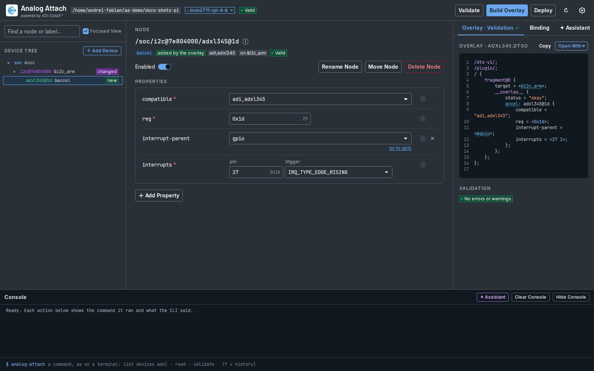

GUI Guide
=========

The GUI is served by the CLI and opened in a browser. Every action in the GUI
runs an ``analog-attach`` command, and the console at the bottom of the page
shows each one, so what you do in the GUI you can also do on the command line.

.. toctree::
   :maxdepth: 1

   starting
   linux/workspace
   linux/adding-devices
   linux/editing
   linux/validate-build-deploy
   error-reporting

* :ref:`ui-starting`: start and stop the GUI, and set up a project.
* :ref:`ui-workspace`: the parts of the page, the settings and the assistant.
* :ref:`ui-adding-devices`: find a device and add it to the overlay.
* :ref:`ui-editing`: properties, child nodes, enable, rename, move and delete.
* :ref:`ui-validate-build-deploy`: validation, build, deploy, and the board's
  settings.
* :ref:`ui-error-reporting`: where the GUI shows errors and warnings.

   The GUI's workspace: the device tree, the node card of an ADXL345, and the
   right column
