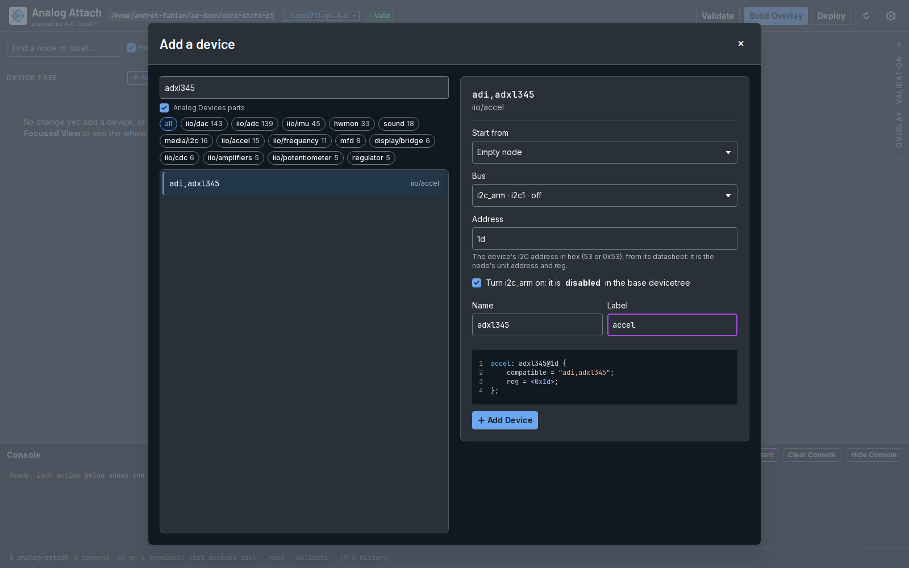

.. _ui-adding-devices:

Adding devices
==============

A device is added to the overlay from the compatibles of the Linux tree: one
per binding. The GUI writes it with ``analog-attach add``, then opens it so
you can set its properties.

The example adds an ADXL345 accelerometer to the I2C bus of a Raspberry Pi 4
(``/soc/i2c@7e804000``, labelled ``i2c1`` and ``i2c_arm``), at address
``0x1d``.

Find the device
---------------

#. Optional: open the bus in the device tree first (type ``i2c_arm`` in its
   search box, then click the bus). The panel then preselects it as the
   device's bus, when the device can go there.

#. Click **＋ Add Device**, above the device tree. The **Add a device** panel
   opens. The first time, it reads the compatibles of the Linux tree, which
   takes a moment.

#. Type in the search box, for example ``adxl345``. Every word you type must
   be in the compatible or in its binding's folder, so ``accel adxl`` or
   ``iio/adc ad71`` work too.

   * **Analog Devices parts**, on by default, limits the list to ``adi,``
     compatibles. Clear it to search all of them. When no Analog Devices part
     matches, **Search All** does the same.
   * The tags under the search box are the binding folders with the most
     devices (``iio/adc``, ``iio/accel``, …), with their counts. Click one to
     list only its devices, and **all** to list them all again.

#. Click ``adi,adxl345`` in the list.

   Add Device with adi,adxl345 picked, on the bus i2c1 at the address 1d

Place it
--------

On the right, the panel shows the compatible picked and the fields of the new
node. Under them, a preview shows the node as it will be written, and follows
what you type.

**Start from**
   Shown when there is something to copy. **Empty node** (the default) starts
   with what the binding requires. **Node from example** copies one of the
   binding's examples, and **Node from overlay** the node of one of the Linux
   tree's overlays that add this device, with how it fits your board.

**Bus** or **Parent**
   Where the node goes. It is **Bus** when the device goes on an SPI or I2C
   bus, else **Parent**: the node it goes under. Each bus is listed by its
   labels; ``· off`` marks one that is disabled in the base devicetree.

   For the example, pick **i2c_arm · i2c1** (``/soc/i2c@7e804000``): the list
   shows every label of a bus, and ``· off`` when it is disabled in the base.

**Address** (I2C)
   The device's I2C address, in hex (``1d`` or ``0x1d``), from its datasheet.
   It becomes the node's unit address and its ``reg``. The hint lists the
   addresses already used on the bus.

   For the example, type ``1d``.

**Chip select** (SPI)
   Which CS line the device is wired to. Each one says whether it is free, or
   which node uses it (``used by spidev@0``). It becomes the node's unit
   address and its ``reg``. If the line is in use, **Turn off spidev@0, which
   uses this chip select** is ticked: the overlay disables that node.

**Turn <bus> on**
   Shown, and ticked, when the bus is disabled in the base devicetree. Keep it
   ticked: the overlay then enables the bus too.

**Name** and **Label**
   Optional. Left empty, the CLI chooses them: the placeholder shows what it
   will write. The name gets the address or the chip select as its unit
   address (``accelerometer@1d``). The label is what references to the node
   use (``&label``).

Then click **＋ Add Device**.

After adding
------------

The panel closes, the new node opens in the node card, and the device tree
shows it tagged **new**. Required properties with only one possible value, or
with a default, are set at once.

The required properties still to set are listed first, empty and marked in
red. Set them, and any others you need, as described in :ref:`ui-editing`.
For the ADXL345 wired to GPIO 27 of the Raspberry Pi, for example:

* ``interrupt-parent``: ``gpio``
* ``interrupts``: ``27`` and ``IRQ_TYPE_EDGE_RISING``

If a property is not in the list, add it with **＋ Add Property**.

If the CLI refuses to add the device, the panel stays open, with the reason
under **＋ Add Device**, so you can correct the fields.

Other ways to add
-----------------

* **Start from an overlay of the Linux tree**: the project setup's
  **Import Overlay** (see :ref:`ui-project-setup`) makes a new workfile from
  one, with all its devices. Later, the console's command line does the same,
  for example ``import <overlay>``. Import writes a new file and makes it the
  project's workfile: it does not add to the overlay you have.
* **Child nodes**, such as the channels of an ADC, are added from their
  parent's node card (see :ref:`ui-editing-children`).
* **A node for a property**: a property that takes a label (a clock, a
  regulator) offers to add a node for it, from its list (see
  :ref:`ui-editing-properties`).
* **The assistant** adds devices from a description (see
  :ref:`ui-workspace-assistant`).
