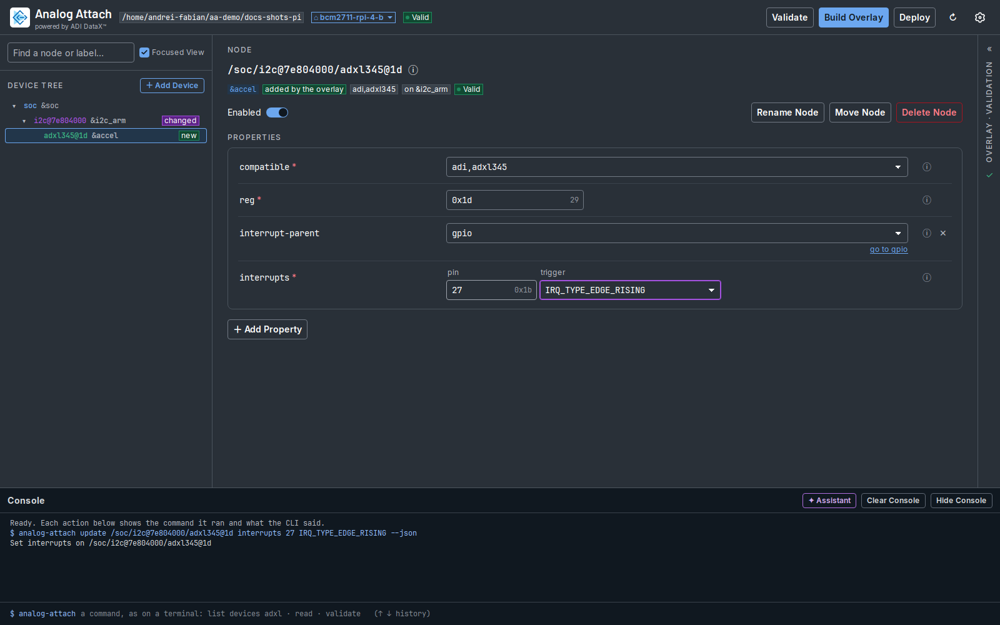

.. _ui-editing:

Editing
=======

The node card, in the middle of the workspace, shows the node you opened and
changes it. Each change is one ``analog-attach`` command (``update``,
``delete``, ``rename``, ``move``, ``enable`` or ``disable``), written to the
overlay as soon as you make it. The console shows each command.

   The node card of the ADXL345 (accelerometer@1d), with interrupt-parent
   and interrupts set

Open a node
-----------

* Click it in the device tree.
* Click a reference (``&gpio``) or a label in the overlay, on the right.
* Click an error in the Validation list.
* Click **go to <label>** under a field that holds a label, to open the node
  it names. The node opened this way has **← back to <name>**, to go back
  one step.

The head of the card shows the node's path and tags: its label
(``&accelerometer``), whether the overlay added it (**added by the
overlay**), changes it (**base, changed by the overlay**) or not
(**base only**), its compatible, and the bus it was added on
(``on &i2c_arm``). For a node the overlay added, a chip says whether it is
**Valid** or how many errors it has. **ⓘ** next to the path shows what the
binding says of the device.

.. _ui-editing-properties:

Properties
----------

The properties are listed in one column, each with a field for its value:

* The properties the binding requires come first, marked ``*``. Those still to
  set are empty and marked in red, until you give them a value. For a device
  with ``interrupts``, ``interrupt-parent`` comes just before it, since it
  sets the shape of ``interrupts``.
* The node's other properties follow, as the overlay has them.
* A property of the base devicetree is tagged **base**. A change to it is
  written to the overlay; the base devicetree is never changed.

Change a value
~~~~~~~~~~~~~~

Type in the field. The change is written when you leave the field, or press
:kbd:`Enter`. The field matches the property's type:

* **A number or text** is one field. While you type a number, its other
  form is shown greyed at the right (``29`` shows ``0x1d``, ``0x1d`` shows
  ``29``); what you type is what is written.
* **A choice** is a list.
* **A flag** (a property with no value) is a switch.
* **A list of cells** (``interrupts``, ``reg``, a GPIO) has one field per
  cell, with named values offered where the binding lists them. For the
  ADXL345 on GPIO 27, ``interrupts`` takes ``27`` and
  ``IRQ_TYPE_EDGE_RISING``. Where a property takes several rows (or a
  list of any length), **＋ Row** (or **＋ Cell**) adds one and ✕ removes
  one. The value is written once all of its cells are filled.
* **A label** (``interrupt-parent``, a clock, a regulator) is typed or picked
  without its ``&``, for example ``gpio``. When the field holds a label that
  exists, **go to <label>** opens that node. Where you can add a node for
  it, the list ends with entries such as **＋ Add a fixed-clock…**: pick one
  to add that node, set the property to its label, and open it.
* **A value the binding fixes** shows that value. If it isn't set yet,
  a button sets it (**Set <value>**, or **Set Flag**).

Next to each property, **ⓘ** shows what the binding says of it, and **✕**
removes it. Properties that can't be removed have no ✕: the
``compatible``, a property the binding requires, and one of the base
devicetree.

If the CLI refuses a value, the field keeps what you typed, marked, with the
reason under it, so you can correct it. What dt-validate says of a property is
also shown under its field (see :ref:`ui-validate-build-deploy`).

To see the type of each property (``uint32 · 0 to 10000000``), turn on
**Preferences** → **Linux** → **Show property types**.

Add a property
~~~~~~~~~~~~~~

#. Click **＋ Add Property** under the properties.
#. On the left, the list has the binding's properties not set yet, the
   required ones first and tagged **required**. Numbered properties
   (``pinctrl-0``) are tagged **numbered**. Type in the filter to find one,
   for example ``supply``, and click it.
#. On the right, the panel shows what the binding says of it, and its value
   field, with suggestions where there are some. Fill the value.
#. Click **＋ Add <property>**. A flag, or a value the binding fixes, can also
   be added with a double-click in the list.

For a property the binding doesn't have, open **Custom Property**: type its
name, choose the kind of its value (**Numbers**, **Text**, **Reference** or
**Flag**), type the value, and click **Add Property**.

**Close** closes the panel.

.. _ui-editing-children:

Child nodes
-----------

A node whose binding has child nodes (the channels of an ADC, for example)
has a **Child nodes** section, or **Channels**, under its properties. It lists
the children, each with its number of properties: click one to open it.

To add one, pick its name in the list (the next free one is preselected, for
example ``channel@0``), and click **＋ Add Channel** (or **＋ Add Child
Node**). The new child opens. A child node that the overlay added has a
button with its parent's name, to go back up to it.

Enable or disable a node
------------------------

The **Enabled** switch sets the node's ``status`` to ``okay`` or
``disabled``. It works on base nodes too: to turn off ``spidev@0`` so that
your device can take its chip select, open it and turn **Enabled** off. The
change goes to the overlay. A disabled node is tagged **off** in the device
tree.

Rename, move and delete
-----------------------

These are offered on nodes that the overlay added.

**Rename Node**
   Changes the node's **Name** and **Unit address**. The unit address is hex,
   and it sets ``reg`` too: renaming ``accelerometer@1d`` to
   ``accelerometer@53`` moves the device to address ``0x53``. The label is
   shown but can't be changed yet.

**Move Node**
   Moves the device, and what is below it, to another bus or parent. The
   dialog lists the buses the device can go on, ``· here`` marking its own.
   Type in the filter to find one, click it, then click **Move Node**. It is
   offered on the devices themselves, not on their child nodes.

**Delete Node**
   Removes the node and what is below it from the overlay, after you confirm.
   References to it are cleared.

If the CLI refuses a change, the reason is shown on the card or in the dialog.
