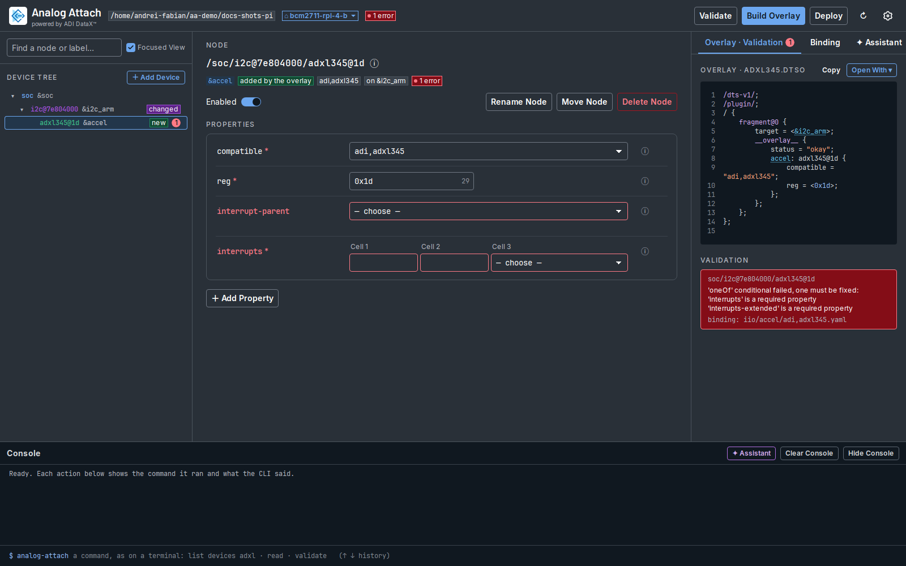
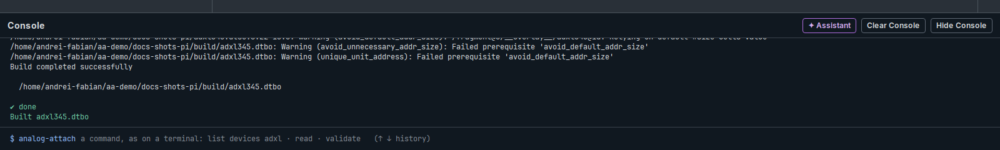
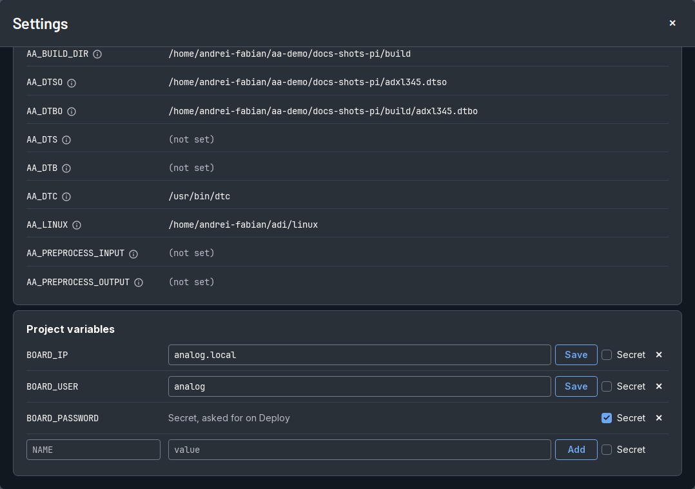
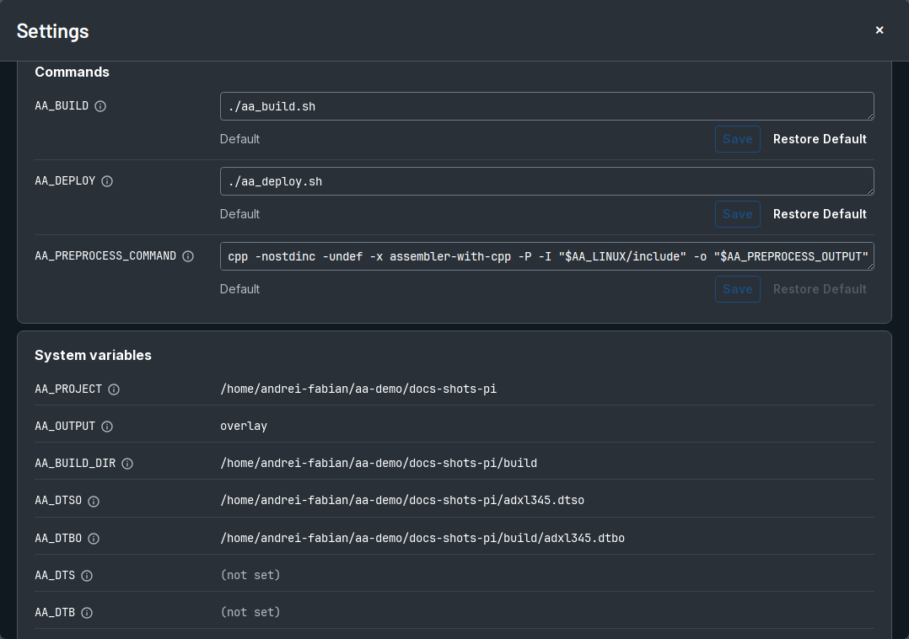

.. _ui-validate-build-deploy:

Validate, build and deploy
==========================

The header has three buttons: **Validate**, **Build Overlay** and **Deploy**.
Each runs the ``analog-attach`` command of the same name, with its output in
the console.

Validate
--------

You don't need to click **Validate** to check the overlay: after each change,
the GUI runs dt-validate on it again. While it works, the status in the
header says ``Validating…``; then it says ``Valid``, ``Valid · 1 warning`` or
``2 errors``.

What dt-validate finds is shown in several places:

* **Validation**, under the overlay in the right column, lists each error and
  warning with the path of its node. Click one to open that node.
* In the device tree, a red number on a node counts its errors.
* In the node card, a chip says whether the node is **Valid**, and an error
  about a property is shown under that property's field.

Until dt-validate has checked the latest change, the findings shown are those
of the change before, dimmed.

   The Overlay · Validation tab with a finding

**Validate** runs ``analog-attach validate`` and opens the console with its
full output.

See :doc:`/cli-guide/linux/validate-build-deploy` for what validation checks.

Build
-----

#. Click **Build Overlay**. The button says **Build Devicetree** when the
   ``output`` setting is ``devicetree``.
#. If dt-validate found errors, the GUI asks first: the build compiles the
   overlay all the same, but the kernel may not probe what is wrong. Click
   **Build Anyway** to go on.
#. The console opens and shows the output of the build as it comes. It ends
   with ``Built overlay.dtbo`` (the name of your overlay), or
   ``✘ Not built: the build refused, above`` with the reason above it.

The build runs the project's build command, ``AA_BUILD``, which by default is
the project's ``./aa_build.sh``. It writes to the ``build/`` folder of the
project (the ``build-dir`` setting):

* with ``output`` set to ``overlay``: ``build/overlay.dtbo``;
* with ``output`` set to ``devicetree``: the full devicetree,
  ``build/overlay.dts``, and its ``build/overlay.dtb``. The right column can
  then show the ``.dts`` (see :ref:`ui-workspace`).

   The console after Build Overlay: dtc's output, then the .dtbo it wrote

Deploy
------

**Deploy** runs the project's deploy command, ``AA_DEPLOY``, which by default
is the project's ``./aa_deploy.sh``. That script copies the build to a
Raspberry Pi running Kuiper, over SSH, and reboots it: an overlay into the
boot folder's ``overlays/``, with ``dtoverlay=<name>`` added to
``config.txt``, or with ``output`` set to ``devicetree``, the ``.dtb`` over
the boot folder's ``devicetree.dtb``. It needs ``ssh``, ``scp`` and
``sshpass`` on the machine where the GUI runs.

Build before you deploy: the script deploys what the last build wrote.

#. Set the board's address and user (see `Set the target`_ below).
#. Click **Deploy**.
#. The first time, a dialog asks for ``BOARD_PASSWORD``. Type it and click
   **Deploy**. The GUI keeps it in the page until you close the page, and
   gives it to the deploy only. It is never saved, and never shown in the
   console.
#. The console opens and shows the output as it comes. If the board refuses
   the password, the dialog asks for it again. A deploy that fails ends with
   ``✘ Not deployed: the deploy refused, above``.

.. _ui-build-deploy-commands:

Set the target
--------------

What Build and Deploy run, and for which board, is set in the settings: the
gear in the header, then the **Project** tab.

Project variables
~~~~~~~~~~~~~~~~~

The project's own variables, given to the build and deploy commands in their
environment. When **Create Overlay** wrote ``aa_deploy.sh``, it also set the
three variables the script uses, to Kuiper's defaults:

.. list-table::
   :header-rows: 1

   * - Variable
     - Default
     - Meaning
   * - ``BOARD_IP``
     - ``analog.local``
     - The board's address or host name
   * - ``BOARD_USER``
     - ``analog``
     - The user to log in as
   * - ``BOARD_PASSWORD``
     - a secret
     - That user's password

To point them at your board:

#. In the row of ``BOARD_IP``, type the board's address, for example
   ``192.168.2.10``, and click **Save**.
#. Do the same for ``BOARD_USER`` if it isn't ``analog``.

To add a variable, type its name and value in the last row and click
**Add**. **✕** removes a variable.

**Secret** makes a variable a secret: its value is never stored, only its
name. Deploy asks for it, or takes it from the environment the GUI was
started in, for example:

.. code-block:: bash

   BOARD_PASSWORD=analog analog-attach gui

The row of a secret says where its value comes from: the GUI's environment,
given on Deploy, or asked for on Deploy. **Forget** drops a value given on
Deploy, so the next Deploy asks again.

   The project variables of a new Raspberry Pi project: BOARD_IP, BOARD_USER and the secret BOARD_PASSWORD

Commands
~~~~~~~~

The commands the CLI runs, each a shell command of one or more lines, run
with ``sh`` in the project folder:

* ``AA_BUILD``: what **Build** runs. Default: ``./aa_build.sh``, which
  compiles with ``dtc``.
* ``AA_DEPLOY``: what **Deploy** runs. Default: ``./aa_deploy.sh``.
* ``AA_PREPROCESS_COMMAND``: what preprocesses the devicetrees, each time a
  command reads one. Default: ``cpp`` with the includes of the Linux tree.

Edit a command in its box, then click **Save** (or press
:kbd:`Ctrl+Enter`). **Restore Default** goes back to the default. For
``AA_BUILD`` and ``AA_DEPLOY``, it also writes the starter ``aa_build.sh`` or
``aa_deploy.sh`` when the project folder has none. An existing script is
kept: it may be yours. To write the starter over it, run
``analog-attach init --restore build`` (or ``deploy``).

**Create Overlay** writes both scripts in the project folder, unless they
are there already. **Import Overlay** doesn't: in a project started from an
imported overlay, click **Restore Default** on ``AA_BUILD`` and ``AA_DEPLOY``
to write them, and the board's variables with them.

The scripts are yours to edit: to deploy to another board, change
``aa_deploy.sh``, or set ``AA_DEPLOY`` to your own command.

   The Commands: AA_BUILD, AA_DEPLOY and AA_PREPROCESS_COMMAND, each with Restore Default

System variables
~~~~~~~~~~~~~~~~

What the CLI gives the commands, worked out from the settings, read-only:
for example ``AA_OUTPUT`` (the ``output`` setting), ``AA_DTSO`` (the
workfile), ``AA_DTBO`` (the ``.dtbo`` to write) and ``AA_BUILD_DIR`` (the
build folder). Click **ⓘ** on a row for what it holds and which commands get
it.

See :doc:`/cli-guide/linux/validate-build-deploy` for the same steps on the
command line.
