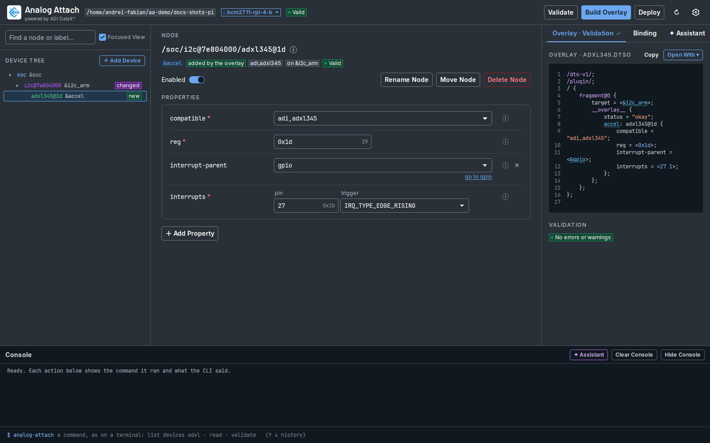
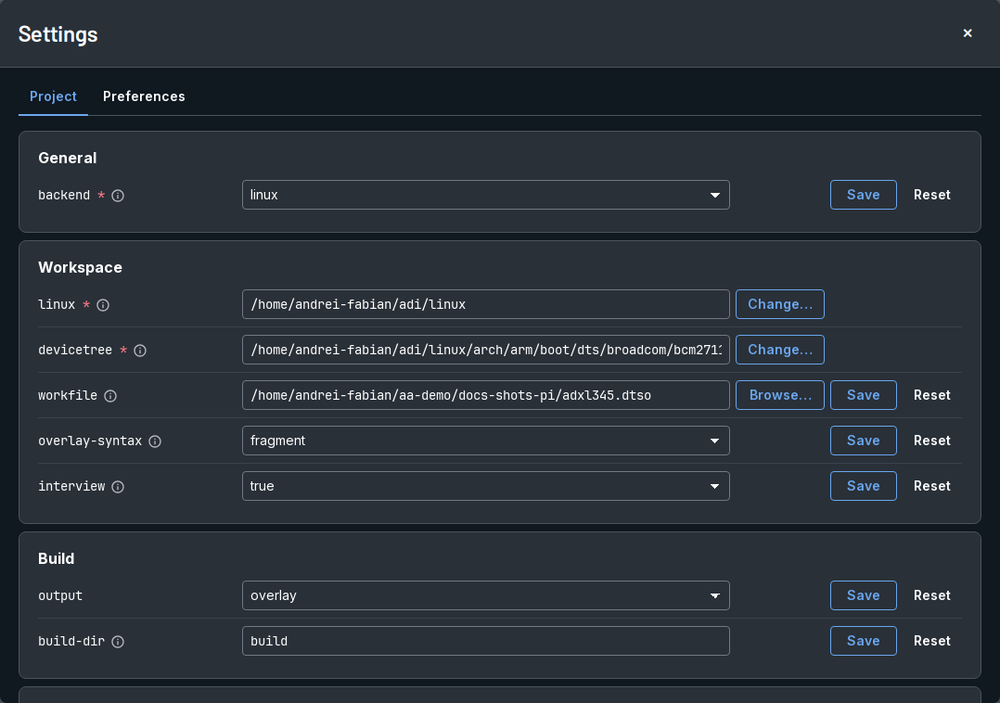
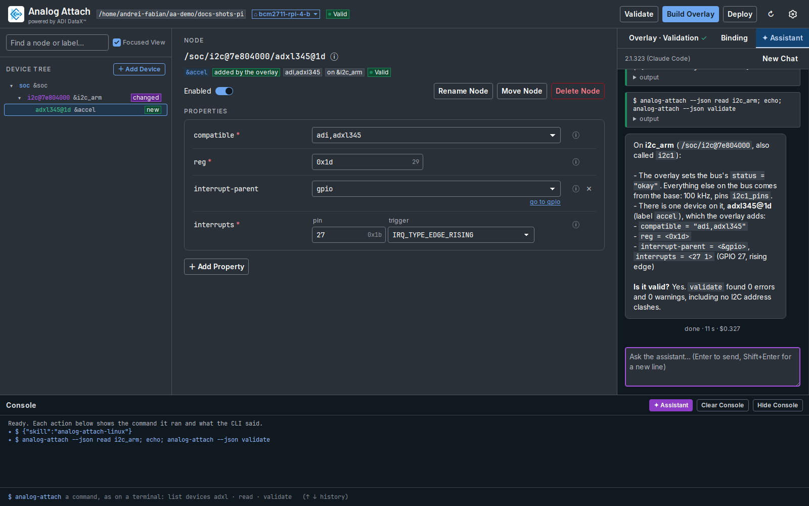

.. _ui-workspace:

Workspace
=========

Once the project is set up (see :ref:`ui-project-setup`), the GUI shows the
workspace of a Linux project: a header, three columns, and a console at the
bottom.

   The workspace of a Raspberry Pi 4 project with an ADXL345 added: the
   header, the device tree, the node card, the right column and the console

The header
----------

From left to right:

* The **project folder**.
* The **base devicetree**, for example ``⌂ bcm2711-rpi-4-b``. Click it to
  pick another base devicetree.
* The **status** of the overlay: ``Updating…`` while a change is written,
  ``Validating…`` while dt-validate checks it, then ``Valid``,
  ``Valid · 2 warnings`` or ``3 errors``.
* **Validate**, **Build Overlay** and **Deploy**. See
  :ref:`ui-validate-build-deploy`.
* **↻** reads the whole project again, for example after you edited the
  overlay in another program.
* The **gear** opens the settings: the project's and the GUI's (see
  :ref:`ui-workspace-settings`).

The device tree
---------------

The left column shows the devicetree as it is with the overlay applied to the
base devicetree.

* Each node shows its name and its label (``&i2c1``). A node the overlay adds
  is tagged **new**, a base node it changes **changed**, and a disabled node
  **off**. A red number counts the validation errors on a node.
* Click ▸ to open a node, ▾ to close it. Nodes with changes below them open by
  themselves.
* Click a node to open it in the node card (see :ref:`ui-editing`).
* **Find a node or label…** searches the whole tree by node name, label or
  compatible, for example ``i2c_arm`` or ``adxl``. A leading ``&`` is
  ignored.
* **Focused View**, on by default, shows only what the overlay adds or
  changes, the way to it, and the other nodes on the buses it adds devices to
  (``spidev@0``, for example). Clear it to browse the whole base devicetree.
* **＋ Add Device** adds a device to the overlay (see
  :ref:`ui-adding-devices`).

The node card
-------------

The middle column shows the node you opened: its properties, its child nodes
and its actions. With no node open, it says
``Select a node to see its properties``. See :ref:`ui-editing`.

The right column
----------------

The right column is folded to a narrow ribbon at first. Click the ribbon to
open it, and **»** to fold it again. Drag its left edge to change its width;
double-click the edge to reset it. It has three tabs:

**Overlay · Validation**
   The overlay as saved, with the lines of the last change highlighted for a
   moment. A reference such as ``&i2c_arm`` or a label is a link to its node.
   **Copy** copies the overlay; **Open With** opens the file in an editor or
   the file manager. Under it, **Validation** lists what dt-validate says of
   the overlay, or ``No errors or warnings``. Click an error to open the node
   it is about.

   With the ``output`` setting at ``devicetree``, once you have built, the tab
   can also show the full ``.dts`` that the build wrote: switch between
   **Overlay** and **Full .dts**. If the overlay changed since that build, the
   tab says the file is older than the overlay.

**Binding**
   The binding file (YAML) of the node open, from the Linux tree: the one of
   its compatible, or for a node without one (a channel), of the nearest node
   above it that has one.

**✦ Assistant**
   A chat with an AI agent that changes the project for you (see
   :ref:`ui-workspace-assistant`).

The console
-----------

The console at the bottom shows every command the GUI runs, and what the CLI
answered. Build and deploy write their output there as it comes.

* Under it, the command line takes any ``analog-attach`` command, as on a
  terminal, without the ``analog-attach``: for example
  ``list devices adxl`` or ``read i2c_arm``. Press :kbd:`Up` and :kbd:`Down`
  for the commands you typed before. ``gui`` can't be run from there.
* **Clear Console** empties it, **Hide Console** folds it.
* Drag its top edge to change its height; double-click the edge to reset it.

After a command from the command line, the GUI reads the project again, so the
tree and the node card show its change.

.. _ui-workspace-settings:

Settings and preferences
------------------------

The gear in the header opens **Settings**, with two tabs.

The **Project** tab holds this project's settings, as ``analog-attach config``
has them, by category:

* Each setting has its field, **Save** and **Reset** (back to the default).
  Click **ⓘ** for what a setting does. If the CLI refuses a value, the reason
  is shown under the field.
* The ``linux`` tree and the base ``devicetree`` each have **Change…**, which
  opens the same choice as the project setup.
* **Commands**, **System variables** and **Project variables** set what
  Build and Deploy run, and for which board. See
  :ref:`ui-build-deploy-commands`.

   Settings → Project: the project's settings and its variables

The **Preferences** tab holds the GUI's own preferences, the same for every
project:

* **Appearance** → **Theme**: System, Light or Dark.
* **Files** → **File picker**: Native (the desktop's dialog, the default) or
  Built-in.
* **Assistant**: the AI agent of the chat (see
  :ref:`ui-workspace-assistant`).
* **Linux** → **Show property types**: shows the type of each property, as
  dt-schema gives it, with its limits (``uint32 · 0 to 10000000``).
* **About**: the version of Analog Attach.

.. _ui-workspace-assistant:

The assistant
-------------

The **✦ Assistant** tab, or the **✦ Assistant** button in the console bar,
opens a chat. Tell it what to change in your own words, for example
*add an ADXL345 on i2c_arm at 0x1d* or *why does validate fail?*. It runs
``analog-attach`` commands for you, and nothing else. Each command shows in
the chat with its output, and in the console marked ✦. The workspace shows the
changes as it makes them.

* **Stop Answer** stops the answer under way.
* **New Chat** forgets the conversation. Otherwise the GUI keeps one
  conversation per project for as long as it runs.

Choose who answers in **Preferences** → **Assistant**:

* **Executable**: an agent installed on your machine, with your own login:
  Claude Code, Codex CLI or Gemini CLI. Claude Code and Gemini CLI may run
  only ``analog-attach`` commands. Codex CLI is held by its sandbox: it writes
  only in the project folder, and has network access (Deploy reaches the
  board).
* **Server**: a model behind an OpenAI-compatible endpoint (a local Ollama or
  LM Studio, for example): its **Endpoint**, **Model name** and **API key**.
  The model must support tool calls. The API key is kept in your own
  settings, never in the project.

If the model can't answer (its program is not installed, for example), the
chat says why and offers **Choose Model**. If the ``analog-attach-linux``
skill is not installed for the agent, the chat offers **Install Skill**.

   The ✦ Assistant panel

See :doc:`/ai-agents/index` for working with AI agents.
