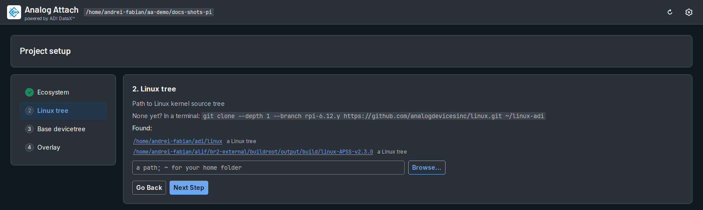

.. _ui-starting:

Starting
========

The GUI is a page in your browser, served by the ``analog-attach`` CLI on your
own machine. Each GUI belongs to one project: the folder you start it in.

Start the GUI
-------------

#. Open a terminal in the project folder. For a new project, make an empty
   folder first:

   .. code-block:: bash

      mkdir ~/rpi-adxl345
      cd ~/rpi-adxl345

#. Run:

   .. code-block:: bash

      analog-attach gui

   The CLI prints where the page is, then opens it in your default browser:

   .. code-block:: none

      analog-attach GUI on http://127.0.0.1:5177  (project: /home/user/rpi-adxl345). Stop it with Ctrl-C.

   If no browser opens (there is no ``xdg-open``, ``open`` or ``explorer``),
   open that URL yourself.

#. Leave the terminal open: the GUI runs for as long as the command does.

The header of the page shows the project folder. To work on another project,
start another ``analog-attach gui`` in that project's folder. Several GUIs can
be open at once, each on its own port.

The port
~~~~~~~~

The page is served on ``127.0.0.1`` only, so only your own machine can reach
it. Without ``--port``, the GUI uses port 5177. If 5177 is taken (for example,
by another open GUI), it takes the first free port of the 20 after it, else any
free port. The URL printed always tells you which.

To choose the port:

.. code-block:: bash

   analog-attach gui --port 8080   # this port, or an error if it is taken
   analog-attach gui --port 0      # any free port

A port you give is never changed. If it is taken, the CLI stops with:

.. code-block:: none

   Port 8080 on 127.0.0.1 is in use (another analog-attach gui?): pick another with --port, or --port 0 for any free one

To serve the page without opening a browser, add ``--server-only``.

Stop the GUI
------------

Press :kbd:`Ctrl+C` in the terminal where the GUI runs. The CLI prints
``Stopped the GUI at <url>`` and exits. Close the browser tab too: the page
can't do anything without its server.

The GUI saves each change as you make it, in the project's settings and its
workfile, so there is nothing to save before you stop it.

.. _ui-project-setup:

The project setup
-----------------

A folder with no project settings yet, or one without a workfile, opens on
the **Project setup**. It has the same steps as the guided setup of the CLI.
Each step saves one setting with ``analog-attach config``. If the CLI refuses
a value, the step shows why, and you can correct it. The steps are listed on
the left: a step that is done has a ✓, and you can click any step to go back
to it.

   The project setup on its Linux tree step: the list of steps on the left,
   the Linux trees found, the path field with Browse…, and Next Step.

The example below sets up a project for a Raspberry Pi 4.

#. **Ecosystem.** Pick **Linux** (device tree overlays for a Linux board).

#. **Linux tree.** Choose the Linux kernel source tree to take the bindings
   and includes from. The step lists the Linux trees it found near the project
   folder and in your home folder. Click one, or type a path (or click
   **Browse…**), then click **Next Step**.

   If you have none yet, the step shows a ``git clone`` command for the ADI
   Linux tree. If you give a folder inside a tree (its ``arch/``, for example),
   the step offers the tree's root folder instead: click **Use It**.

   Saving the tree builds the binding caches. This can take a few seconds,
   and the step says so while it works.

#. **Base devicetree.** Choose the devicetree of your board. The step lists
   the ``.dts`` files of the Linux tree, the Raspberry Pis first, each with the
   board's name. Type in the filter to find one, for example ``rpi-4``, and
   click ``bcm2711-rpi-4-b.dts`` (Raspberry Pi 4 Model B). For a file that is
   not listed, type its path under **Pick custom path**, or click
   **Browse…**.

   .. figure:: https://github.com/analogdevicesinc/analog-attach/raw/doc_resources/resources/gui-setup-devicetree.png
      :width: 100%

      The base devicetree step: the suggestions for ``rpi-4``, with
      bcm2711-rpi-4-b.dts

#. **Overlay.** Set the optional settings of the overlay:

   * ``workfile``: the file name of the overlay in the project folder. Left
     empty, it is ``overlay.dtso``. If a valid workfile of that name exists
     already, the GUI uses it.
   * ``overlay-syntax``: how the overlay is written, ``fragment``
     (``fragment@0 { target = <&spi0>; __overlay__ { … }; };``) or
     ``reference`` (``&spi0 { … };``).
   * ``output``: what a build writes: ``overlay`` (a ``.dtbo``) or
     ``devicetree`` (the base with the overlay applied, as a ``.dts`` and a
     ``.dtb``).

   Then start the overlay:

   * **Create Overlay** creates an empty overlay.
   * **Import Overlay** opens the list of the overlays of the Linux tree. Type
     the name of an overlay or of a part it adds (``adxl``, ``ad7124``), check
     how it fits your base devicetree (``compatible`` or ``incompatible``),
     and click **Import Overlay** on its row.

   .. figure:: https://github.com/analogdevicesinc/analog-attach/raw/doc_resources/resources/gui-setup-overlay.png
      :width: 100%

      The overlay step: the workfile, the overlay syntax and the output

When the overlay exists, the GUI opens the project's workspace (see
:ref:`ui-workspace`).

If you start the GUI in a project that is set up already, it opens the
workspace directly. If the overlay is deleted later, or the ``workfile``
setting is changed to a file that doesn't exist, the GUI goes back to the
setup's **Overlay** step.

To change the Linux tree or the base devicetree later, use the Project tab of
the settings (see :ref:`ui-workspace-settings`), or click the base devicetree
in the header.

Choosing files
~~~~~~~~~~~~~~

**Browse…** opens your desktop's file dialog: the desktop portal's file
chooser, else ``zenity``, ``kdialog`` or ``yad`` (on macOS, its own dialog).
Where none of them can open, Browse… opens the GUI's built-in picker and says
why. To always use the built-in picker, open the settings (the gear in the
header), then **Preferences** → **Files** → **File picker** → **Built-in**.

The native dialog only picks files that exist. To name a new file, type its
name in the field.

Using the GUI from another machine
----------------------------------

The GUI only answers on ``127.0.0.1``. To use it from another computer, for
example when the Linux tree is on a build server, forward the port over SSH.

#. On your computer, connect with the same port number on both sides:

   .. code-block:: bash

      ssh -L 5177:127.0.0.1:5177 user@build-server

   The port must be the same on both ends: the GUI refuses requests that are
   not addressed to its own ``127.0.0.1:<port>`` or ``localhost:<port>``.

#. In that SSH session, start the GUI in the project folder, on that port and
   without a browser:

   .. code-block:: bash

      cd ~/rpi-adxl345
      analog-attach gui --server-only --port 5177

#. On your computer, open ``http://127.0.0.1:5177``.

A native file dialog opens on the machine where the GUI runs, not on yours.
Over SSH, set **Preferences** → **Files** → **File picker** to **Built-in**.
