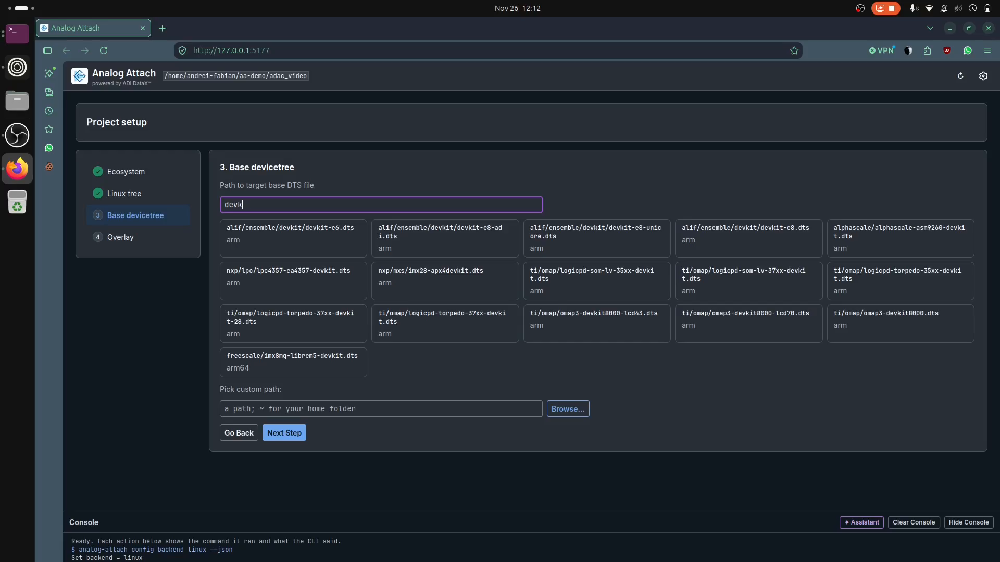
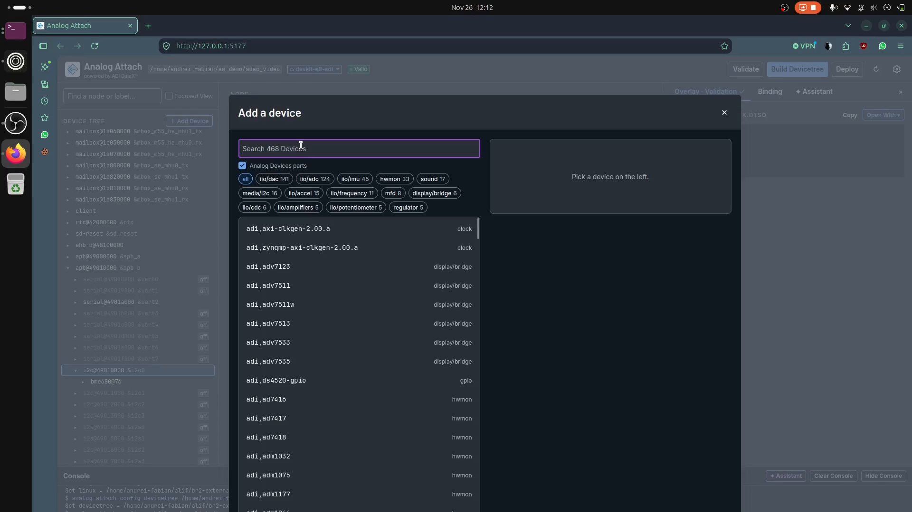
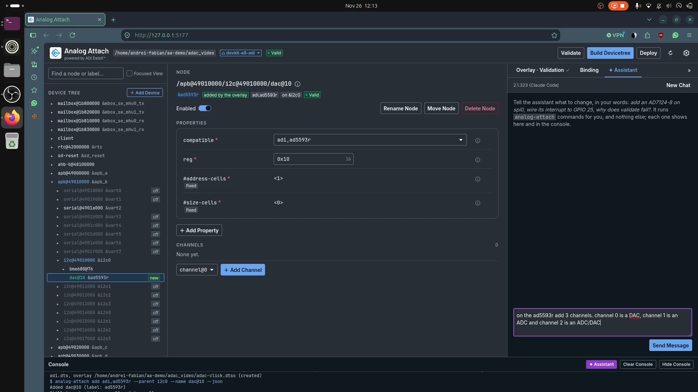
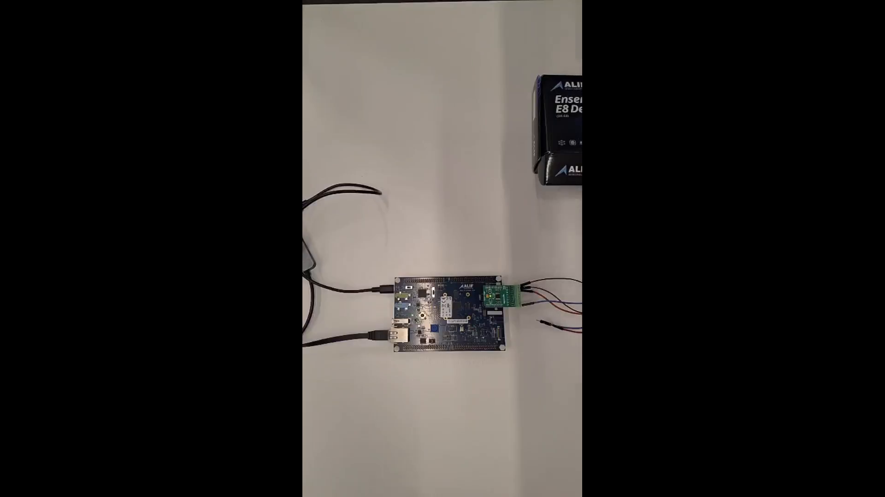
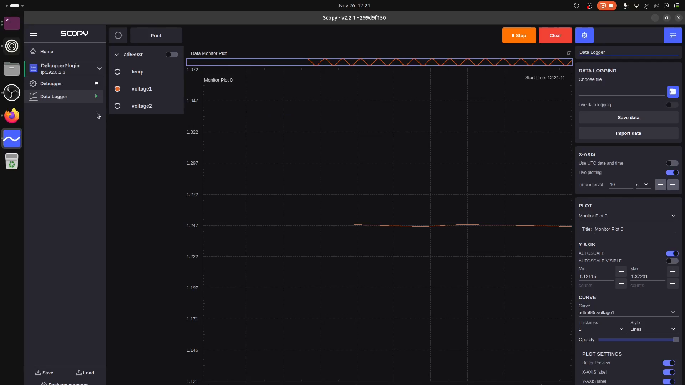

.. _use-case-ui-ai-agent:

Use case: GUI with an AI agent
==============================

Goal
----

Add an AD5593R (8-channel ADC, DAC and GPIO) to the devicetree of an Alif
Ensemble DK-E8 with the GUI, let the GUI's Assistant set up its channels, build
the devicetree, flash it, and read the channels back in Scopy.

The DK-E8 boots a single devicetree from its MRAM and has no overlay support,
so this project builds a full devicetree (``output`` is ``devicetree``) instead
of an overlay. The steps are the same for a Raspberry Pi, where the result is an
overlay copied to the board.

What you need
-------------

.. list-table::
   :header-rows: 1

   * - Item
     - Details
   * - Board / carrier
     - Alif Ensemble DK-E8, running Linux built with Buildroot (``br2-external``
       for the DK-E8, kernel ``linux-APSS-v2.3.0``)
   * - Evaluation board / part
     - MikroElektronika ADAC Click (AD5593R), in the DK-E8's mikroBUS socket
       (GND towards the centre of the board). Click jumpers: ADDR SEL ``0``
       (I2C address ``0x10``), LOG SEL ``3V3``. Board jumper JP7 (Click IO) on
       ``3V3``. A wire between the Click's IO0 and IO1, so a DAC channel can be
       read back by an ADC channel.
   * - Cables and power
     - USB-C to the DK-E8's PRG USB port (power, flashing and the serial
       console); Ethernet to the host, for Scopy
   * - Host
     - Linux machine with Analog Attach installed, Alif SETOOLS (to flash the
       MRAM), ``picocom``, Scopy, and an AI coding agent for the Assistant
       (Claude Code here)
   * - Software versions
     - Analog Attach 0.2.0, Linux ``APSS-v2.3.0`` (Alif), Scopy 2.2.1

Walkthrough video
-----------------

.. video:: https://github.com/analogdevicesinc/analog-attach/raw/doc_resources/resources/aa-v0.2.0-alif-ad5593r-gui-ai.mp4

   ADAC Click (AD5593R) on the Alif DK-E8: GUI, Assistant, flashing and Scopy

Steps
-----

Step 1: Prepare the project folder
~~~~~~~~~~~~~~~~~~~~~~~~~~~~~~~~~~

Build and deploy are the project's ``aa_build.sh`` and ``aa_deploy.sh``. The
starters that ``analog-attach init`` writes are for a Raspberry Pi, so for the
DK-E8 put two scripts of your own in the project folder before the setup (the
setup keeps scripts that are there):

- ``aa_build.sh`` compiles ``$AA_DTS`` (the full devicetree, preprocessed) into
  ``$AA_DTB`` with the kernel's own ``dtc``, as Buildroot does (without
  ``-@``, so the DTB fits the DTB area in MRAM).
- ``aa_deploy.sh`` packs ``$AA_DTB`` with the Buildroot images and writes the
  MRAM with SETOOLS over the PRG USB port.

The board devicetree ``devkit-e8-adi.dts`` includes ``devkit-e8.dts`` from
its own folder, so the preprocessor needs that folder too. Set the project
variable ``AA_PREPROCESS_COMMAND`` (in the GUI: the **Project** tab):

.. code-block:: bash

   cpp -nostdinc -undef -x assembler-with-cpp -P -I "$AA_LINUX/include" \
       -I "$AA_LINUX/arch/arm/boot/dts/alif/ensemble/devkit" \
       -o "$AA_PREPROCESS_OUTPUT" "$AA_PREPROCESS_INPUT"

Step 2: Start the GUI and set up the project
~~~~~~~~~~~~~~~~~~~~~~~~~~~~~~~~~~~~~~~~~~~~

.. code-block:: bash

   cd ~/aa-demo/adac
   analog-attach gui

The setup asks for:

.. list-table::
   :header-rows: 1

   * - Step
     - Value
   * - Ecosystem
     - **Linux**
   * - Linux tree
     - The kernel Buildroot unpacked, suggested by the GUI:
       ``…/buildroot/output/build/linux-APSS-v2.3.0``
   * - Base devicetree
     - ``devkit-e8-adi.dts``, the board's devicetree (pick it from the
       suggestions or give its path)
   * - Overlay: workfile
     - ``adac-click.dtso``
   * - Overlay: output
     - **devicetree** (the DK-E8 boots one full DTB)

Then click **Create Overlay**.

   The project setup: the workfile, the overlay syntax and the output

Step 3: Add the AD5593R
~~~~~~~~~~~~~~~~~~~~~~~

Click **＋ Add Device**, search for ``ad5593`` and pick **adi,ad5593r**, on
the bus **i2c0** (``/apb@49010000/i2c@49010000``, the mikroBUS I2C). Pick
``adi,ad5593r``, not ``adi,ad5592r``: the AD5592R is the SPI version of the
part, and its driver never binds to a node on an I2C bus.

On the new node, set the properties the binding requires:

.. list-table::
   :header-rows: 1

   * - Property
     - Value
   * - ``reg``
     - ``0x10`` (ADDR SEL on 0)
   * - ``#address-cells``
     - ``1``
   * - ``#size-cells``
     - ``0``

``vref-supply`` stays unset: the part then uses its internal 2.5 V reference.

   The AD5593R on i2c0, its required properties set

Step 4: Set up the channels with the Assistant
~~~~~~~~~~~~~~~~~~~~~~~~~~~~~~~~~~~~~~~~~~~~~~

Open **✦ Assistant** and ask, for example:

   On the AD5593R add 3 channels: channel 0 as a DAC, channel 1 as an ADC and
   channel 2 as both. Use numeric adi,mode values. Then validate.

The Assistant runs ``analog-attach`` commands only; each one shows in the chat
and in the console, and the tree updates as it goes:

.. list-table::
   :header-rows: 1

   * - Channel
     - ``reg``
     - ``adi,mode``
     - Meaning
   * - ``channel@0``
     - ``0``
     - ``2``
     - DAC (drives IO0)
   * - ``channel@1``
     - ``1``
     - ``1``
     - ADC (reads IO1, wired to IO0)
   * - ``channel@2``
     - ``2``
     - ``3``
     - DAC and ADC

``adi,mode`` takes 1 (ADC), 2 (DAC), 3 (DAC and ADC) or 8 (GPIO).

   The Assistant adding the channels, the commands it ran in the chat

Step 5: Validate, build and flash
~~~~~~~~~~~~~~~~~~~~~~~~~~~~~~~~~

#. Click **Validate**: no errors.
#. Click **Build Overlay**: ``build/adac-click.dtb``, the board's devicetree
   with the AD5593R in it.
#. Set the DK-E8's SW4 to **SE**, then click **Deploy**. Flashing takes a
   couple of minutes and ends with ``Deploy completed successfully``.

Step 6: Boot the board
~~~~~~~~~~~~~~~~~~~~~~

#. Set SW4 to **U2** (the Linux console on the PRG USB port).
#. Open the console and press the reset button:

   .. code-block:: bash

      picocom -b 115200 /dev/ttyACM0

#. Log in as ``root`` and check the part:

   .. code-block:: console

      # i2cdetect -y -r 0
      ...
      10: UU -- -- -- -- -- -- -- -- -- -- -- -- -- -- --
      # cat /sys/bus/iio/devices/iio:device0/name
      ad5593r

``UU`` means the driver has the device.

   Linux booting on the DK-E8 with the new devicetree

Step 7: Read the channels in Scopy
~~~~~~~~~~~~~~~~~~~~~~~~~~~~~~~~~~

#. Connect the Ethernet cable; the DK-E8 runs ``iiod``.
#. In Scopy, add the device with the URI ``ip:<board address>`` and connect.
#. In **IIO Explorer** (Debugger), write ``ad5593r`` ``voltage0`` (output)
   ``raw``: 0 to 4095 is 0 to 2.5 V.
#. In **Data Logger**, plot ``voltage1``: it follows the DAC through the
   IO0–IO1 wire.

Result
------

The AD5593R probes at boot, its DAC drives IO0 and its ADC reads it back on
IO1: writing 2048 to ``out_voltage0_raw`` reads about 2044 on
``in_voltage1_raw``.

   Scopy's Data Logger following the DAC on voltage1

The workfile written by the GUI and the Assistant:

.. code-block:: dts

   /dts-v1/;
   /plugin/;
   / {
   	fragment@0 {
   		target = <&i2c0>;
   		__overlay__ {
   			ad5593r: dac@10 {
   				compatible = "adi,ad5593r";
   				reg = <0x10>;
   				#address-cells = <1>;
   				#size-cells = <0>;
   				channel@0 {
   					reg = <0>;
   					adi,mode = <2>;
   				};
   				channel@1 {
   					reg = <1>;
   					adi,mode = <1>;
   				};
   				channel@2 {
   					reg = <2>;
   					adi,mode = <3>;
   				};
   			};
   		};
   	};
   };

Troubleshooting
---------------

- **Deploy says "Target did not respond".** SW4 is not fully on SE, or the
  board needs a power cycle: set SW4 to SE, unplug and plug the PRG USB cable,
  and deploy again.
- **The console shows nothing.** SW4 must be on U2 for the Linux console, and
  only one program can have ``/dev/ttyACM0`` open: close ``picocom`` before
  deploying.
- **No device at 0x10, no error in dmesg.** Check that the node's compatible is
  ``adi,ad5593r`` (not ``adi,ad5592r``), that the Click is seated with GND
  towards the centre of the board, and that ADDR SEL is on 0.
- **The Assistant writes ``CH_MODE_*`` macros.** Ask it for the numeric
  ``adi,mode`` values instead.

Next steps
----------

- :ref:`use-case-template`, to write up another board or part.
