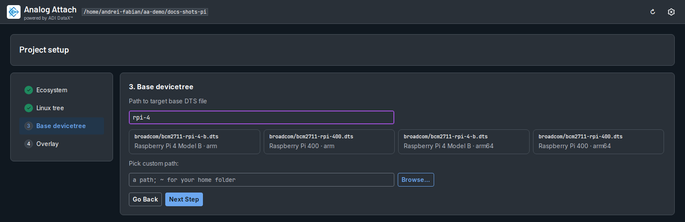
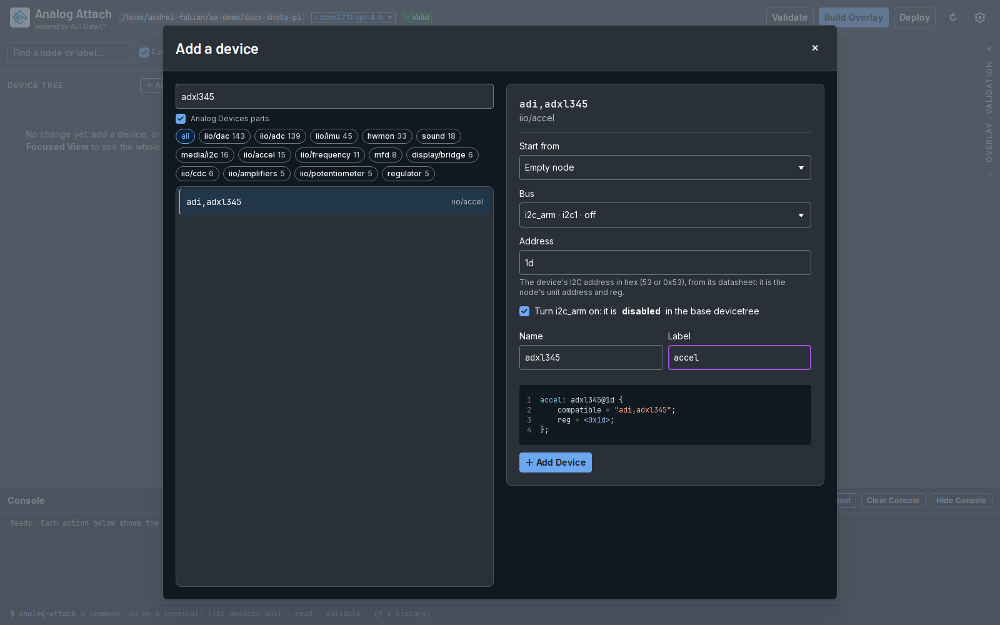
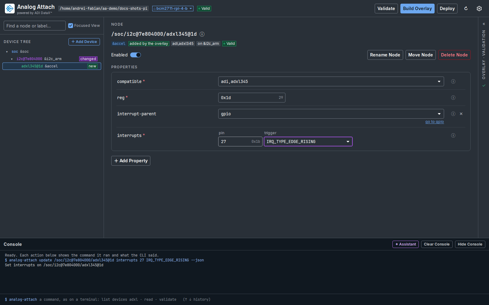

.. _use-case-ui:

Use case: Configure a device with the GUI
=========================================

Goal
----

Add an ADXL345 accelerometer to a Raspberry Pi 4 with the GUI: set up the
project, add the part and its interrupt, validate, build and deploy the
overlay, and read the acceleration back over the network.

What you need
-------------

.. list-table::
   :header-rows: 1

   * - Item
     - Details
   * - Board / carrier
     - Raspberry Pi 4 Model B, running ADI Kuiper
   * - Evaluation board / part
     - MikroElektronika Accel Click (ADXL345), set for I2C at address
       ``0x1d`` with its jumpers
   * - Wiring
     - Five jumper wires from the Click to the Pi's 40-pin header:

       ========== ==========================
       Click      Raspberry Pi header
       ========== ==========================
       3V3        pin 1 (3.3 V)
       GND        pin 6 (GND)
       SDA        pin 3 (GPIO 2, I2C1 SDA)
       SCL        pin 5 (GPIO 3, I2C1 SCL)
       INT        pin 13 (GPIO 27)
       ========== ==========================
   * - Cables and power
     - The Pi's USB-C power supply; an Ethernet cable from the Pi to the host.
       Here the host shares its connection over that cable, and the Pi gets
       ``10.42.0.196``. Any address the host can reach works.
   * - Host
     - Linux machine with Analog Attach installed (see :doc:`/install/index`),
       a web browser, ``ssh``, ``scp`` and ``sshpass`` for the deploy, and the
       libiio tools (``iio_info``) to read the part
   * - Software versions
     - Analog Attach 0.2.0; the ADI Linux tree (``analogdevicesinc/linux``,
       its Raspberry Pi branch) in ``~/linux``

Steps
-----

Step 1: Wire the Click
~~~~~~~~~~~~~~~~~~~~~~

With the Pi off, connect the Click as in the table above. On the Pi 4,
GPIO 2 and 3 are the I2C bus labelled ``i2c1`` and ``i2c_arm`` in its
devicetree.

Step 2: Start the GUI and set up the project
~~~~~~~~~~~~~~~~~~~~~~~~~~~~~~~~~~~~~~~~~~~~

.. code-block:: bash

   mkdir -p ~/work/rpi4-adxl345 && cd ~/work/rpi4-adxl345
   analog-attach gui

The browser opens on the **Project setup** (see :ref:`ui-project-setup`):

.. list-table::
   :header-rows: 1

   * - Step
     - Value
   * - Ecosystem
     - **Linux**
   * - Linux tree
     - ``~/linux``, from the trees the step found
   * - Base devicetree
     - ``bcm2711-rpi-4-b.dts`` (type ``rpi-4`` in the filter)
   * - Overlay
     - ``workfile`` empty (``overlay.dtso``), ``overlay-syntax``
       ``fragment``, ``output`` ``overlay``

Then click **Create Overlay**. The workspace opens.

   The base devicetree step, with bcm2711-rpi-4-b.dts among the suggestions

Step 3: Add the ADXL345
~~~~~~~~~~~~~~~~~~~~~~~

#. Click **＋ Add Device** and type ``adxl345``. Click ``adi,adxl345``.
#. **Bus**: **i2c_arm · i2c1** (``/soc/i2c@7e804000``).
#. **Address**: ``1d``.
#. Keep **Turn i2c1 on** ticked: the bus is disabled in the Pi 4's base
   devicetree, and the overlay enables it.
#. Leave **Name** and **Label** empty, and click **＋ Add Device** under the
   preview. The console shows the ``analog-attach add`` it ran.

See :ref:`ui-adding-devices` for every field of the panel.

   Add Device with adi,adxl345 picked, on the bus i2c1 at the address 1d

Step 4: Set the interrupt
~~~~~~~~~~~~~~~~~~~~~~~~~

The new node opens in the node card. Its required ``interrupt-parent`` and
``interrupts`` are missing, and validation says so.

#. ``interrupt-parent``: pick ``gpio``.
#. ``interrupts``: ``27`` in the first cell and ``IRQ_TYPE_EDGE_RISING`` in
   the second.

Each change is written to the overlay as you make it (see
:ref:`ui-editing-properties`).

   The ADXL345's node card with interrupt-parent and interrupts set

Step 5: Validate
~~~~~~~~~~~~~~~~

The GUI validates after every change. The header now says ``Valid``, and the
**Validation** tab of the right column has no errors. Had the bus been left
off, a warning there would say that Linux won't probe the device (see
:ref:`ui-validate-build-deploy`).

Step 6: Build and deploy
~~~~~~~~~~~~~~~~~~~~~~~~

#. Click **Build Overlay**. The console ends with ``Built overlay.dtbo``.
#. Open the settings (the gear), the **Project** tab, and set ``BOARD_IP`` to
   the Pi's address, ``10.42.0.196``; the default is ``analog.local``.
   ``BOARD_USER`` stays ``analog``. See :ref:`ui-build-deploy-commands`.
#. Click **Deploy**, and type the password of ``analog`` when asked. The
   console shows the script copying ``overlay.dtbo`` to the Pi, adding
   ``dtoverlay=overlay`` to ``config.txt`` and rebooting the Pi.

Result
------

When the Pi is back, the ADXL345 is an IIO device:

.. code-block:: bash

   iio_info -u ip:10.42.0.196 | grep -A3 adxl345

lists ``adxl345`` with its channels ``accel_x``, ``accel_y`` and ``accel_z``.
Read the raw values on the Pi:

.. code-block:: text

   $ ssh analog@10.42.0.196
   $ cd /sys/bus/iio/devices/iio:device0     # the device whose name is adxl345
   $ cat name in_accel_x_raw in_accel_y_raw in_accel_z_raw
   adxl345
   2
   1
   253

With the board lying flat, X and Y are close to 0 and Z reads about 253: 1 g,
gravity, at about 3.9 mg per count.

The workfile the GUI wrote:

.. code-block:: dts

   /dts-v1/;
   /plugin/;
   / {
   	fragment@0 {
   		target = <&i2c_arm>;
   		__overlay__ {
   			status = "okay";
   			adxl345: accelerometer@1d {
   				compatible = "adi,adxl345";
   				reg = <0x1d>;
   				interrupt-parent = <&gpio>;
   				interrupts = <27 1>;
   			};
   		};
   	};
   };

With **Name** and **Label** left empty, the node is named
``accelerometer@1d`` and labelled ``adxl345``. ``IRQ_TYPE_EDGE_RISING`` is
written as its value, ``1``.

Troubleshooting
---------------

- **No adxl345 in iio_info.** On the Pi, ``sudo i2cdetect -y 1`` should show
  ``UU`` at ``1d``. A number at ``53`` means the Click's address jumper is the
  other way: set ``reg`` to ``0x53`` in the node card, then build and deploy
  again. Nothing at all: check the wiring.
- **Deploy can't reach the Pi.** ``analog.local`` needs mDNS; set ``BOARD_IP``
  to the Pi's IP address. See :doc:`/troubleshooting/index`.

Next steps
----------

- :doc:`/use-cases/linux/cli/index`: the same from the command line.
- :ref:`use-case-ui-ai-agent`: the GUI with its Assistant, on another board.
- :doc:`/ui-guide/index`: the GUI in detail.
