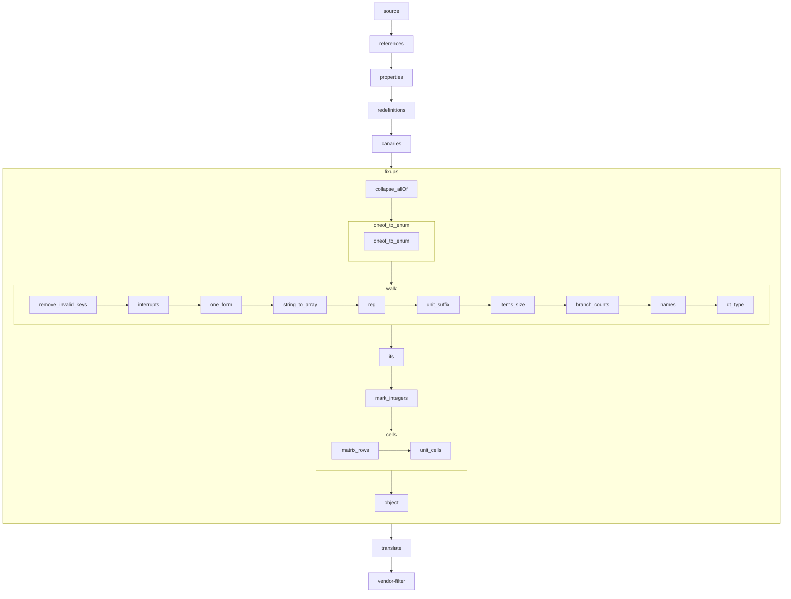

<!-- Generated by yarn docs:pipeline (scripts/pipeline-doc/build.mjs): edit scripts/pipeline-doc/intro.md, the steps' summaries (PIPELINE_STAGES, fixup_passes, PARSE_STEPS) or the walkthroughs' list, not this file. -->

# How attach-lib reads a binding

`Attach.parse(binding, paths)` turns a devicetree binding (a JSON Schema in YAML, from the Linux tree) into a
`ParsedBinding`. That is, for each property the CLI can write, its type (`AttachType`: a flag, a number, a list or
matrix of cells, an enum of values, a child node) and the counts and bounds the binding gives it. This page lists
the steps it takes, generated from the list the code runs (`PARSE_STEPS`, `fixup_passes`), and follows a few
properties of real bindings through them.

## Why it differs from dt-schema

dt-schema validates a devicetree against the binding as written. It keeps each `$ref` to `types.yaml`
(`uint32-array`, `phandle-array`, ...) and reads a property's type from it. We need one schema per binding that says
everything about a property in one place, both for AJV to compile and for `translate` to read. So the `references`
stage replaces every `$ref` with what it names. That would lose the name of the type, so the resolver first tags each
`types.yaml` definition with its name (`dtType`).

The `fixups` stage then does what dt-schema's `fixups.py` does to every schema before validating: a string property is
a list of strings, a `reg` bounded as a number is one cell, a unit suffix types the property. Our own passes guess
what dt-schema reads from the `$ref`s we replaced: which schemas are integers (`mark_integers`), what a matrix's
rows are (`matrix_rows`), the bounds of a unit's numbers (`unit_cells`). A fixup that ports one of dt-schema's names
it in the table below. One without a dt-schema counterpart is ours.

## Branches and the canary

A binding's `allOf` entries hold `if` / `then` / `else` branches: a property that is required, or takes other
values, only for some `compatible`. `canaries` puts a `__canary__: false` property in each `then` and `else`. When the
CLI asks what applies to a node (`update_binding_by_changes`), the node's data goes to AJV with `__canary__: true`.
Each branch that applies fails on it, the error's schema path names the branch, and that branch is merged into the
binding, which is translated again. That is all the CLI uses AJV for. What checks a devicetree is dt-validate.

## Reading the walkthroughs

Each walkthrough follows one property from its YAML to its `ParsedBinding` entry and lists only the steps that
changed it. A diff line is `+ /pointer: value` for an addition and `- /pointer: value` for a removal; a changed value
is both. The pointer is relative to the property. `(at /oneOf/1)` means the fixup ran on that branch of the property:
the walk fixes a property's branches before the property itself.

To follow any other property, run `node scripts/repros/stages.mjs <binding> [property]` (`--pattern <regex>` for a
child node's), or open every property of a binding in the browser with `yarn pipeline:view <binding>`.

## The steps

`source` is the binding as its file has it. The stages run top to bottom; the fixup passes run inside `fixups`, and each walk applies its fixups (left to right) to every node schema and property.



| step | what it does | dt-schema |
| --- | --- | --- |
| `source` | The binding as its YAML file has it. |  |
| `references` | Replaces every `$ref` with what it names, and tags each `types.yaml` definition with its name (`dtType`); dt-schema keeps the `$ref`s. Each file's own counts are fixed as it is read (`fixups.py:_fixup_items_size`), before its `$ref`s bring others. |  |
| `properties` | Fills each `property: true` placeholder with its definition from the files the binding references. |  |
| `redefinitions` | Merges the `allOf` re-definitions of a property into its root definition. |  |
| `canaries` | Puts the `__canary__` property in each `allOf` `then` / `else`, so that validation tells which branches apply. |  |
| `fixups` | Patches the schema the way dt-schema's fixups do, and guesses the types dt-schema reads from the `$ref`s (`fixup_passes`). | `fixups.py` |
| `fixups › collapse_allOf` | Flattens the `allOf` the dereferencing leaves in a property into one schema. |  |
| `fixups › oneof_to_enum` | A walk of its own, before the others turn each `const` of a `oneOf` into a list. |  |
| `fixups › oneof_to_enum › oneof_to_enum` | A `oneOf` / `anyOf` of nothing but `const`s is an `enum`. | `fixups.py:_fixup_oneOf_to_enum` |
| `fixups › walk` | The fixups of each node schema and property, as dt-schema's `fixups.py:fixup_sub_schema` walks them. |  |
| `fixups › walk › remove_invalid_keys` | Drops what validation doesn't need (`maintainers`, `$schema`, `select`) from every node schema. | `fixups.py:fixup_schema` |
| `fixups › walk › interrupts` | A node with `interrupts` can have an `interrupt-parent`, one phandle. | `fixups.py:fixup_interrupts` |
| `fixups › walk › one_form` | A property a `oneOf` / `anyOf` gives several forms of is the one to write: the one not deprecated, the flag rather than the number. |  |
| `fixups › walk › string_to_array` | A string property is a list of strings: `{enum: [a, b]}` constrains its first item. | `fixups.py:_fixup_string_to_array` |
| `fixups › walk › reg` | A `reg` whose values are bounded as numbers is a one-cell entry with those bounds. | `fixups.py:_fixup_reg_schema` |
| `fixups › walk › unit_suffix` | A property with a unit suffix (`-ns`, `-hz`) is a list or a matrix of numbers; its constraints move to where that type has them. | `fixups.py:_fixup_unit_suffix_props` |
| `fixups › walk › items_size` | An array gets its type, and a fixed count when its `items` is a list or only one of `minItems` / `maxItems` is given. | `fixups.py:_fixup_items_size` |
| `fixups › walk › branch_counts` | A property is bounded by what all the branches of its `oneOf` / `anyOf` keep to. |  |
| `fixups › walk › names` | A `-names` property is a list of strings, at least one. | `schemas/dt-core.yaml` |
| `fixups › walk › dt_type` | A property that doesn't say its type gets the one dt-schema gives its name (`reg` an address, `-gpios` a phandle-array). | `validator.py:property_get_type` |
| `fixups › ifs` | An `allOf` branch's `if` requires the properties it tests, so that a condition whose properties are absent doesn't match. |  |
| `fixups › mark_integers` | A schema with `minimum` / `maximum` is an integer. | `lib.py:_is_int_schema` |
| `fixups › cells` | After `mark_integers`: the cells these add can be labels or macros, not integers. |  |
| `fixups › cells › matrix_rows` | A matrix property (`reg`, `interrupts`, `clocks`) that doesn't describe its rows gets them, each an array. |  |
| `fixups › cells › unit_cells` | The numbers of a unit property get the bounds of the type its suffix gives. |  |
| `fixups › object` | The binding is an object schema. | `validator.py:process_schema` |
| `translate` | Builds the `ParsedBinding`: each property's `AttachType`, the child-node patterns and the property patterns. |  |
| `vendor-filter` | Drops the vendor-specific SPI peripheral properties (`pl022,`, `nvidia,`) of a controller that isn't the node's, when the controller is given. |  |

## Walkthroughs

Generated from Linux at `3a020df09cee` and dt-schema at `5687115902ba`.

### `compatible` in `iio/accel/adi,adxl345.yaml`

A `oneOf` of a fallback list and an enum. The walk fixes each branch first (`at /oneOf/<n>`), `branch_counts` bounds the property by them, and `translate` makes one `list<enum>` whose options are whole values: the pair `adi,adxl346`, `adi,adxl345` is one option.

#### source

The binding as its YAML file has it.

```yaml
oneOf:
  - items:
      - const: adi,adxl346
      - const: adi,adxl345
  - enum:
      - adi,adxl345
      - adi,adxl375
```

#### references

Replaces every `$ref` with what it names, and tags each `types.yaml` definition with its name (`dtType`); dt-schema keeps the `$ref`s. Each file's own counts are fixed as it is read (`fixups.py:_fixup_items_size`), before its `$ref`s bring others.

```diff
+ /oneOf/0/minItems: 2
+ /oneOf/0/maxItems: 2
+ /oneOf/1/minItems: 1
+ /oneOf/1/maxItems: 1
```

#### fixups › walk › items_size (at /oneOf/0)

An array gets its type, and a fixed count when its `items` is a list or only one of `minItems` / `maxItems` is given. (dt-schema `fixups.py:_fixup_items_size`)

```diff
+ /oneOf/0/type: "array"
```

#### fixups › walk › string_to_array (at /oneOf/1)

A string property is a list of strings: `{enum: [a, b]}` constrains its first item. (dt-schema `fixups.py:_fixup_string_to_array`)

```diff
- /oneOf/1/enum: ["adi,adxl345","adi,adxl375"]
+ /oneOf/1/items: [{"enum":["adi,adxl345","adi,adxl375"]}]
```

#### fixups › walk › items_size (at /oneOf/1)

An array gets its type, and a fixed count when its `items` is a list or only one of `minItems` / `maxItems` is given. (dt-schema `fixups.py:_fixup_items_size`)

```diff
+ /oneOf/1/type: "array"
```

#### fixups › walk › branch_counts

A property is bounded by what all the branches of its `oneOf` / `anyOf` keep to.

```diff
+ /minItems: 1
+ /maxItems: 2
```

#### fixups › walk › dt_type

A property that doesn't say its type gets the one dt-schema gives its name (`reg` an address, `-gpios` a phandle-array). (dt-schema `validator.py:property_get_type`)

```diff
+ /dtType: "string-array"
```

#### translate

Builds the `ParsedBinding`: each property's `AttachType`, the child-node patterns and the property patterns.

```json
{
  "_t": "list",
  "item": {
    "_t": "enum",
    "enum": [
      [
        "adi,adxl346",
        "adi,adxl345"
      ],
      "adi,adxl345",
      "adi,adxl375"
    ],
    "enum_type": "string"
  },
  "minItems": 1,
  "maxItems": 1
}
```

### `reg` in `iio/adc/adi,ad7124.yaml`

`redefinitions` merges in what `spi-peripheral-props.yaml` says of `reg` (the chip select's bounds), `dt_type` gives it the type dt-schema gives the name (an `address`), and `translate` makes the address a matrix: one row of one cell.

#### source

The binding as its YAML file has it.

```yaml
description: SPI chip select number for the device
maxItems: 1
```

#### references

Replaces every `$ref` with what it names, and tags each `types.yaml` definition with its name (`dtType`); dt-schema keeps the `$ref`s. Each file's own counts are fixed as it is read (`fixups.py:_fixup_items_size`), before its `$ref`s bring others.

```diff
+ /minItems: 1
```

#### redefinitions

Merges the `allOf` re-definitions of a property into its root definition.

```diff
+ /items: {"items":[{"minimum":0,"maximum":256}],"minItems":1,"maxItems":1}
```

#### fixups › walk › items_size

An array gets its type, and a fixed count when its `items` is a list or only one of `minItems` / `maxItems` is given. (dt-schema `fixups.py:_fixup_items_size`)

```diff
+ /items/type: "array"
+ /type: "array"
```

#### fixups › walk › dt_type

A property that doesn't say its type gets the one dt-schema gives its name (`reg` an address, `-gpios` a phandle-array). (dt-schema `validator.py:property_get_type`)

```diff
+ /dtType: "address"
```

#### fixups › mark_integers

A schema with `minimum` / `maximum` is an integer. (dt-schema `lib.py:_is_int_schema`)

```diff
+ /items/items/0/type: "integer"
```

#### translate

Builds the `ParsedBinding`: each property's `AttachType`, the child-node patterns and the property patterns.

```json
{
  "_t": "matrix",
  "minItems": 1,
  "maxItems": 1,
  "rows": [
    {
      "_t": "list",
      "item": {
        "_t": "number",
        "minimum": 0,
        "maximum": 256
      },
      "minItems": 1,
      "maxItems": 1
    }
  ],
  "description": "SPI chip select number for the device"
}
```

### `^channel@([0-9]|1[0-5])$ › reg` in `iio/adc/adi,ad7124.yaml`

A child node's `reg` bounded as a number: the `reg` fixup makes it one entry of one cell with those bounds.

#### source

The binding as its YAML file has it.

```yaml
description: |
  The channel number. It can have up to 8 channels on ad7124-4
  and 16 channels on ad7124-8, numbered from 0 to 15.
items:
  minimum: 0
  maximum: 15
```

#### references

Replaces every `$ref` with what it names, and tags each `types.yaml` definition with its name (`dtType`); dt-schema keeps the `$ref`s. Each file's own counts are fixed as it is read (`fixups.py:_fixup_items_size`), before its `$ref`s bring others.

```diff
+ /maxItems: 1
+ /minItems: 1
```

#### fixups › walk › reg

A `reg` whose values are bounded as numbers is a one-cell entry with those bounds. (dt-schema `fixups.py:_fixup_reg_schema`)

```diff
- /items: {"minimum":0,"maximum":15}
+ /items: [{"items":[{"minimum":0,"maximum":15}]}]
```

#### fixups › walk › items_size

An array gets its type, and a fixed count when its `items` is a list or only one of `minItems` / `maxItems` is given. (dt-schema `fixups.py:_fixup_items_size`)

```diff
+ /items/0/type: "array"
+ /items/0/minItems: 1
+ /items/0/maxItems: 1
+ /type: "array"
```

#### fixups › walk › dt_type

A property that doesn't say its type gets the one dt-schema gives its name (`reg` an address, `-gpios` a phandle-array). (dt-schema `validator.py:property_get_type`)

```diff
+ /dtType: "address"
```

#### fixups › mark_integers

A schema with `minimum` / `maximum` is an integer. (dt-schema `lib.py:_is_int_schema`)

```diff
+ /items/0/items/0/type: "integer"
```

#### translate

Builds the `ParsedBinding`: each property's `AttachType`, the child-node patterns and the property patterns.

```json
{
  "_t": "matrix",
  "minItems": 1,
  "maxItems": 1,
  "rows": [
    {
      "_t": "list",
      "item": {
        "_t": "number",
        "minimum": 0,
        "maximum": 15
      },
      "minItems": 1,
      "maxItems": 1
    }
  ],
  "description": "The channel number. It can have up to 8 channels on ad7124-4\nand 16 channels on ad7124-8, numbered from 0 to 15.\n"
}
```

### `^channel@([0-9a-f])$ › adi,excitation-current-0-nanoamp` in `iio/adc/adi,ad4130.yaml`

A unit suffix (`-nanoamp`) makes the property a list of numbers: `unit_suffix` moves its `enum` to the cells, `items_size` makes it one value, and `dt_type` names the type dt-schema gives the suffix, a `uint32-array`.

#### source

The binding as its YAML file has it.

```yaml
description: |
  Excitation current in nanoamps to be applied to pin specified in
  adi,excitation-pin-0 while this channel is active.
enum:
  - 0
  - 100
  - 10000
  - 20000
  - 50000
  - 100000
  - 150000
  - 200000
default: 0
```

#### fixups › walk › unit_suffix

A property with a unit suffix (`-ns`, `-hz`) is a list or a matrix of numbers; its constraints move to where that type has them. (dt-schema `fixups.py:_fixup_unit_suffix_props`)

```diff
- /enum: [0,100,10000,20000,50000,100000,150000,200000]
+ /items: [{"enum":[0,100,10000,20000,50000,100000,150000,200000]}]
```

#### fixups › walk › items_size

An array gets its type, and a fixed count when its `items` is a list or only one of `minItems` / `maxItems` is given. (dt-schema `fixups.py:_fixup_items_size`)

```diff
+ /type: "array"
+ /minItems: 1
+ /maxItems: 1
```

#### fixups › walk › dt_type

A property that doesn't say its type gets the one dt-schema gives its name (`reg` an address, `-gpios` a phandle-array). (dt-schema `validator.py:property_get_type`)

```diff
+ /dtType: "uint32-array"
```

#### translate

Builds the `ParsedBinding`: each property's `AttachType`, the child-node patterns and the property patterns.

```json
{
  "_t": "list",
  "item": {
    "_t": "enum",
    "enum": [
      0,
      100,
      10000,
      20000,
      50000,
      100000,
      150000,
      200000
    ],
    "enum_type": "number"
  },
  "minItems": 1,
  "maxItems": 1,
  "description": "Excitation current in nanoamps to be applied to pin specified in\nadi,excitation-pin-0 while this channel is active.\n"
}
```
